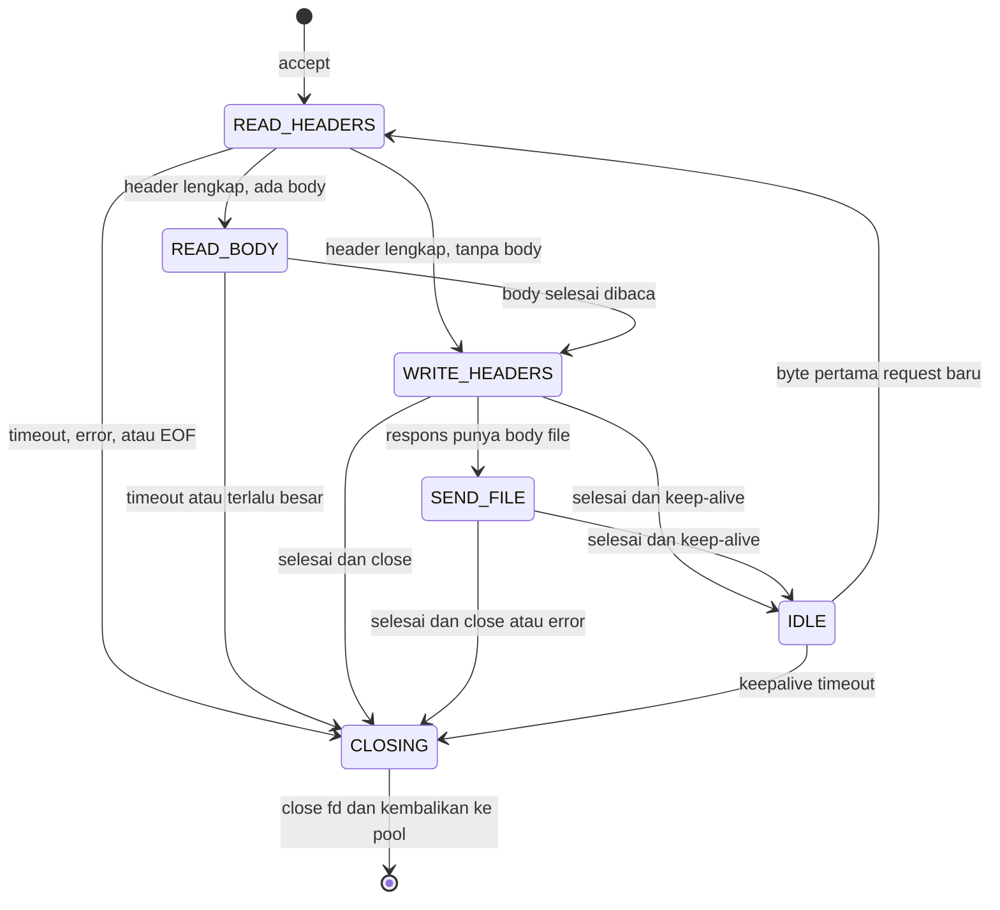

<div align="center">

# Dantrix

**High-performance HTTP/1.1 server based on `epoll`, written in C for Linux.**

*Event-driven · Non-blocking I/O · Zero-copy · Multi-core without shared state*

[](https://github.com/WildanDeveloper/dantrix/actions)
[](https://github.com/WildanDeveloper/dantrix/releases)
[](LICENSE)
[](#system-requirements)
[](#system-requirements)
[](#project-status)
[](#contributing)

[Quick Start](#quick-start) · [Architecture](#architecture) · [Configuration](#configuration) · [Benchmark](#benchmark) · [Roadmap](#roadmap-roadmap) · [Contributing](#contributing)

</div>

---

> [!WARNING]
> **Dantrix is a learning project that is still pre-alpha.** There has been no security audit and it is not suitable for production. For production, use a mature server such as Nginx, Caddy, HAProxy, or Apache httpd. See [Project Status](#project-status) and [Security](#security).

## Table of Contents

- [About Dantrix](#about-dantrix)
- [Project Status](#project-status)
- [Goals and Non-Goals](#goals-and-non-goals)
- [Features](#features)
- [Brief Comparison with Other Servers](#brief-comparison-with-other-servers)
- [Architecture](#architecture)
  - [Overview](#overview)
  - [Thread Model: One Event Loop per Core](#thread-model-one-event-loop-per-core)
  - [Connection Lifecycle (State Machine)](#connection-lifecycle-state-machine)
  - [Event Loop](#event-loop)
  - [Level-Triggered vs Edge-Triggered](#level-triggered-vs-edge-triggered)
  - [Memory Management](#memory-management)
  - [Timers and Timeouts](#timers-and-timeouts)
  - [File Delivery with sendfile](#file-delivery-with-sendfile)
  - [Signals and Graceful Shutdown](#signals-and-graceful-shutdown)
- [System Requirements](#system-requirements)
- [Installation](#installation)
- [Quick Start](#quick-start)
- [Usage](#usage)
- [Configuration](#configuration)
- [HTTP Behavior](#http-behavior)
- [Logging](#logging)
- [Directory Structure](#directory-structure)
- [Learning Path](#learning-path)
- [Operating System Tuning](#operating-system-tuning)
- [Benchmark](#benchmark)
- [Testing](#testing)
- [Security](#security)
- [Debugging and Profiling](#debugging-and-profiling)
- [Deployment](#deployment)
- [Roadmap (Roadmap)](#roadmap-roadmap)
- [Limitations and Trade-offs](#limitations-and-trade-offs)
- [FAQ](#faq)
- [Troubleshooting](#troubleshooting)
- [Contributing](#contributing)
- [Changelog](#changelog)
- [Glossary](#glossary)
- [References](#references)
- [Acknowledgements](#acknowledgements)
- [License](#license)
- [Author](#author)

---

## About Dantrix

Dantrix is an HTTP/1.1 server for Linux written from scratch in C (the C11 standard), with no runtime dependencies other than libc. Its main focus is **handling tens of thousands of concurrent connections** (known as the [C10K problem](#glossary)) with small resources. It does so by:

- one **`epoll`**-based *event loop* per CPU core (a *shared-nothing* model),
- entirely **non-blocking** sockets,
- **zero-copy** file delivery via `sendfile()`,
- memory **allocated up front** (a pool) instead of `malloc`/`free` per connection,
- an **incremental** HTTP parser that is robust against requests arriving in fragments.

Most tutorials stop at an echo server. Dantrix goes further: a complete HTTP server that is **measurable** (there are reproducible benchmark scripts), **tested** (unit tests, integration tests, fuzzing, sanitizers), and **documented**.

This project has two roles:

1. **A learning tool.** Understand socket APIs, non-blocking I/O, `epoll`, connection state machines, concurrency, profiling, and security hardening directly at the operating system level.
2. **A foundation that can be extended.** The event loop and the HTTP parser are designed modularly so they can be reused for a reverse proxy, a WebSocket server, an API gateway, or other protocols (see [Roadmap](#roadmap-roadmap)).

**The name.** *Dantrix* = **Dan** (from the author's name, Wil**dan**) + the **-trix** suffix, a technical-style suffix like the one in *matrix*.

### Summary

| Aspect | Value |
|---|---|
| Language | C (C11 standard) |
| Platform | Linux (kernel ≥ 3.9, ≥ 5.10 recommended) |
| Protocol | HTTP/1.0 and HTTP/1.1 (TLS and HTTP/2 planned for after 1.0) |
| I/O model | `epoll`, non-blocking, one event loop per core |
| Runtime dependencies | libc only |
| Build | `make` |
| Scale target | ≥ 10,000 concurrent connections (C10K) |
| License | MIT |

---

## Project Status

Dantrix is developed with a **README-driven development** approach: this document is written first as a target specification, and the code follows. Therefore **only components marked ✅ actually exist and are tested**. Everything else is a plan.

**Legend:** ✅ done and tested · 🚧 in progress · 📝 planned

| Component | Status | Release target |
|---|---|---|
| Learning material: blocking echo, thread-per-connection, `epoll` echo (`examples/`) | ✅ | v0.1.0 |
| Single-thread `epoll` event loop, non-blocking accept, connection pool | ✅ | v0.1.0 |
| Incremental HTTP/1.1 parser and error responses | ✅ | v0.2.0 |
| Static files: `sendfile`, MIME, `HEAD`, `ETag`, `Range` | ✅ | v0.3.0 |
| Keep-alive, pipelining, timer wheel, timeouts | ✅ | v0.4.0 |
| Defect audit of v0.4.0 (34 defects, regression suite) | ✅ | v0.4.1 |
| Multi-worker with `SO_REUSEPORT` | 📝 | v0.5.0 |
| Configuration, CLI, signals, graceful shutdown and reload | 📝 | v0.6.0 |
| Benchmark suite and optimization | 📝 | v0.7.0 |
| Hardening: fuzzing, sanitizer in CI, security review | 📝 | v0.8.0 |
| Stable release | 📝 | v1.0.0 |

> [!IMPORTANT]
> All performance numbers in this document are **targets** or **placeholders (`TBD`)** until measured with the method described in the [Benchmark](#benchmark) section. Real measurement results will be listed in full, together with hardware specifications, kernel version, and commit hash.

---

## Goals and Non-Goals

### Goals

1. **Connection scalability.** Handle ≥ 10,000 concurrent connections (C10K) as the primary target and 100,000 (C100K) as a *stretch goal*.
2. **Performance.** High throughput and low tail latency (p99) for serving static files.
3. **Code clarity.** Easy to read, commented, and studied; one module, one responsibility.
4. **Minimal dependencies.** Only libc and Linux kernel headers; `make` is enough to build.
5. **Robustness.** Strict parser, resource limits, timeouts, and layered testing (unit, integration, fuzzing, sanitizers).
6. **Measurability.** Every performance claim has a benchmark script that anyone can reproduce.

### Non-Goals

At least until version 1.0, Dantrix is **not** intended to:

- replace Nginx, Caddy, or Apache for general production use;
- run natively on Windows or macOS (`epoll` is Linux-only);
- run application code (no CGI/FastCGI, scripting, or dynamic modules);
- become a web application framework;
- support TLS, HTTP/2, or HTTP/3 (see [Roadmap](#roadmap-roadmap)).

---

## Features

The **Target** column shows the release version in which the feature is scheduled. See [Project Status](#project-status) for the current state.

| Category | Feature | Description | Target |
|---|---|---|---|
| Core | `epoll` event loop | Level-triggered by default, edge-triggered optional | v0.1 |
| Core | Full non-blocking sockets | `accept4`, `SOCK_NONBLOCK`, `SOCK_CLOEXEC` | v0.1 |
| Core | Connection pool | Slab and free-list, no `malloc` per connection | v0.1 |
| Security | Build hardening | PIE, RELRO, stack protector, `_FORTIFY_SOURCE` | v0.1 |
| HTTP | Incremental HTTP/1.1 parser | Zero-copy and strict (resistant to request smuggling) | v0.2 |
| HTTP | Methods `GET`, `HEAD`, `OPTIONS` | `405` or `501` for other methods | v0.2 |
| HTTP | Standard error responses | 400, 403, 404, 405, 408, 413, 414, 416, 431, 500, 501, 505 | v0.2 |
| Operations | Logging | Access and error logs, common and combined formats | v0.2 |
| Operations | Logging | `json` format and per-worker buffered writes | v0.6 |
| Static | Static file serving | Zero-copy `sendfile()` and `MSG_MORE` | v0.3 |
| Static | MIME types | Built-in table and custom file | v0.3 |
| Static | Cache validators | `ETag`, `Last-Modified`, `304 Not Modified` | v0.3 |
| Static | Range requests | Single range (`206`, `416`, `If-Range`) | v0.3 |
| Static | Safe path resolution | Normalization and `openat2(RESOLVE_BENEATH)` | v0.3 |
| Static | Index file and directory listing | `index.html`; optional listing (disabled by default) | v0.3 |
| Connection | Keep-alive and pipelining | Request limit per connection | v0.4 |
| Connection | Timeouts | Header, body, send, idle (O(1) timer wheel) | v0.4 |
| Scale | Multi-core `SO_REUSEPORT` | One event loop per core; optional CPU affinity | v0.5 |
| Operations | Layered configuration | File, environment variable, CLI flag | v0.6 |
| Operations | Signals | Graceful shutdown, reload, reopen log | v0.6 |
| Operations | Status endpoint | JSON metrics (optional, loopback only) | v0.6 |
| Security | Privilege drop | `setgid`/`setuid`, `no_new_privs` | v0.6 |
| Performance | Reproducible benchmark | `wrk`, `wrk2`, comparison with Nginx | v0.7 |
| Quality | Layered testing | Unit, integration, fuzzing, ASan/UBSan/TSan | v0.8 |

---

## Brief Comparison with Other Servers

This comparison is **qualitative** and is not a performance claim.

| | Dantrix | Nginx | Caddy | Apache httpd | `python -m http.server` |
|---|---|---|---|---|---|
| Language | C | C | Go | C | Python |
| I/O model | `epoll` event loop per core | Event-driven, one worker per core | Goroutines on top of the Go runtime | MPM (prefork, worker, or event) | Thread per connection |
| HTTPS | Not yet (planned) | Yes | Yes (automatic HTTPS) | Yes | Not by default |
| HTTP/2 | Not yet (planned) | Yes | Yes | Yes | No |
| Maturity | Pre-alpha | Very mature | Mature | Very mature | Development tool |
| Purpose | Learning and experimentation | Production | Production | Production | Local development |

---

## Architecture

### Overview

```text
                         +-----------------------------+
 Client --- TCP -------> |  Linux kernel (TCP/IP)      |
 (10,000+ connections)   |  SO_REUSEPORT: 4-tuple hash |
                         +--------------+--------------+
                                        |
              +-------------------------+-------------------------+
              |                         |                         |
        listen fd #0              listen fd #1             listen fd #N-1
              |                         |                         |
       +------v------+           +------v------+           +------v------+
       |  Worker 0   |           |  Worker 1   |           | Worker N-1  |
       |-------------|           |-------------|           |-------------|
       | epoll       |           | epoll       |           | epoll       |
       | conn pool   |           | conn pool   |           | conn pool   |
       | timer wheel |           | timer wheel |           | timer wheel |
       | log buffer  |           | log buffer  |           | log buffer  |
       +-------------+           +-------------+           +-------------+
              ^                         ^                         ^
              +---- eventfd (shutdown, reload, statistics) -------+
                                        |
                             +----------+-----------+
                             |     Main thread      |
                             | signalfd, config     |
                             +----------------------+
```

- The **main thread** reads the configuration, raises the file descriptor limit, creates the listeners, runs the workers, and then waits for signals via `signalfd`. It does **not** handle requests.
- A **worker** is a thread with its own event loop. Each worker has its own `epoll` instance, listener (`SO_REUSEPORT`), connection pool, timer wheel, log buffer, and local statistics. No state is shared between workers, so there are **no locks in the hot path**.
- **Inter-thread communication** happens only through each worker's `eventfd` (commands: shutdown, configuration reload, statistics dump).

### Thread Model: One Event Loop per Core

Dantrix uses a **shared-nothing** model:

1. The main thread creates *N* listeners. Each listener is a separate TCP socket `bind()`ed to the same address and port with the `SO_REUSEPORT` option.
2. The kernel distributes incoming connections across those listeners based on a hash of the 4-tuple (source IP and port, destination IP and port). There is no single *acceptor* thread that becomes a bottleneck, and no lock on the accept queue.
3. Each worker handles its own connections from `accept` to `close`. Connections **never move** between threads.

**Advantages:** no locks, CPU caches stay warm, behavior is easy to reason about and debug.

**Disadvantages:** connection distribution is not always even (it is hash-based), especially when there are few clients or the connections are long-lived. A blocked worker (for example by disk I/O) holds up all of its own connections. See [Limitations and Trade-offs](#limitations-and-trade-offs).

**Alternative mode (`reuseport = false`).** All workers share a single listener that is registered with each worker's `epoll` using the `EPOLLEXCLUSIVE` flag (Linux ≥ 4.5) to avoid a *thundering herd*. Useful for older kernels or as a comparison baseline.

**CPU affinity (`cpu_affinity = true`).** The *i*-th worker is pinned to the *i*-th core via `pthread_setaffinity_np`, reducing cross-core migration. Best results when combined with IRQ and RSS settings on the NIC (see [Operating System Tuning](#operating-system-tuning)).

> [!NOTE]
> All sockets using `SO_REUSEPORT` must be created by processes with the same *effective UID*. This kernel rule prevents other processes from hijacking the port.

### Connection Lifecycle (State Machine)

Every connection is a small state machine. `epoll` events drive transitions between states.



| State | Meaning | `epoll` interest | Timeout that applies |
|---|---|---|---|
| `READ_HEADERS` | Incrementally reading the request line and headers | `EPOLLIN` | `header_timeout` |
| `READ_BODY` | Reading and discarding the body (if any) | `EPOLLIN` | `body_timeout` |
| `WRITE_HEADERS` | Sending response headers (and small/error bodies) | `EPOLLOUT` only if `send` returns `EAGAIN` | `send_timeout` |
| `SEND_FILE` | Sending file contents with `sendfile()` | `EPOLLOUT` only if `EAGAIN` | `send_timeout` |
| `IDLE` | Keep-alive, waiting for the next request | `EPOLLIN` (read buffer released) | `keepalive_timeout` |
| `CLOSING` | `shutdown`/`close`, object returned to the pool | none | none |

Request processing (parsing, path resolution, evaluation of conditional headers) happens **synchronously** between `READ_*` and `WRITE_HEADERS` because it involves no blocking I/O, except for disk access (see [Limitations and Trade-offs](#limitations-and-trade-offs)).

> [!TIP]
> In level-triggered mode the socket is almost always *writable*. If `EPOLLOUT` is registered continuously, the event loop will spin without stopping (a *busy loop*). Therefore Dantrix **only registers `EPOLLOUT` when there is pending data** after `EAGAIN`, and removes it as soon as the data has been fully sent.

### Event Loop

The following skeleton is only an **illustration** (simplified); the final code will differ.

```c
/* Ilustrasi: kerangka event loop satu worker */
for (;;) {
    int timeout_ms = timer_wheel_next_timeout_ms(&w->timers);
    int n = epoll_wait(w->epfd, events, DX_MAX_EVENTS, timeout_ms);

    if (n < 0) {
        if (errno == EINTR)
            continue;
        log_error(w, "epoll_wait: %s", strerror(errno));
        break;
    }

    for (int i = 0; i < n; i++) {
        uint64_t tag = events[i].data.u64;   /* indeks + generasi, bukan pointer mentah */
        uint32_t ev  = events[i].events;

        switch (tag_kind(tag)) {
        case DX_TAG_LISTENER:
            accept_loop(w);                  /* accept4() sampai EAGAIN */
            break;
        case DX_TAG_WAKEUP:
            handle_wakeup(w);                /* eventfd: shutdown, reload, statistik */
            break;
        case DX_TAG_CONN: {
            dx_conn_t *c = pool_lookup(&w->pool, tag);
            if (c == NULL)
                break;                       /* slot sudah didaur ulang: abaikan event usang */
            if (ev & (EPOLLERR | EPOLLHUP)) {
                conn_close(w, c);
                break;
            }
            if (ev & EPOLLIN)
                conn_on_readable(w, c);
            if (!conn_is_closed(c) && (ev & EPOLLOUT))
                conn_on_writable(w, c);
            break;
        }
        }
    }

    timer_wheel_advance(&w->timers, now_ms(), on_timeout, w);
    log_flush_if_needed(w);

    if (w->stopping && pool_active(&w->pool) == 0)
        break;
}
```

Principles that are maintained:

- `epoll_wait` is the only call that deliberately waits. Its timeout is computed from the nearest timer.
- One iteration processes at most `DX_MAX_EVENTS` events (default 1024), then runs timers and flushes logs.
- Events carry the **index and generation** of the connection slot. If the slot has been recycled, the stale event is recognized and ignored.
- Every syscall result is checked, including `EINTR`, `EAGAIN`, and `EWOULDBLOCK`.

### Level-Triggered vs Edge-Triggered

| Aspect | Level-triggered (default) | Edge-triggered (`edge_triggered = true`) |
|---|---|---|
| Notification | As long as the fd is ready | Only when a change occurs (new data arrives) |
| Application obligation | May read partially | **Must** read or write until `EAGAIN` |
| Risk | More wakeups | Lost events if not drained; one busy connection can starve the others |
| Complexity | Lower | Higher |
| When to use | Default, debugging | Optimization experiments (v0.7), compared via benchmarks |

In both modes, Dantrix limits the number of consecutive operations per event (a per-connection *budget*) so that one busy connection does not hold up other connections.

### Memory Management

- **Connection pool (slab and free-list).** Connection objects are allocated per *chunk* (for example 1,024 objects at a time) and recycled through a free-list. There is no `malloc`/`free` per connection in the hot path. Each slot has a *generation counter* to recognize stale references.
- **On-demand read buffers.** New connections use a small buffer (4 KiB) from a per-worker pool that grows gradually up to `max_header_size`. When an idle keep-alive connection has an empty buffer, the buffer is returned to the pool. As a result, idle connections consume very little memory.
- **Zero-copy parser.** The parser stores *offsets and lengths* inside the buffer, not string copies. Offsets (not pointers) are used so that it is safe when the buffer is moved while growing.
- **File contents never cross user space.** `sendfile()` moves data directly from the page cache to the socket.
- **Response headers are assembled with bounded append functions** (no `sprintf`) into a fixed buffer. The `Date` header string is cached per second per worker.
- **Allocation failures are handled**: the connection is closed and a warning is logged, rather than `abort()`.
- **Design target:** ≤ 1 KiB of user-space state per idle connection. This number has not been verified yet and does not include kernel memory for the socket (a few KiB per connection, depending on `tcp_rmem` and `tcp_wmem`).

### Timers and Timeouts

Dantrix uses a ***hashed timing wheel***: 1 second per slot, 256 slots, with a rotation counter for timeouts longer than one rotation. Each connection holds one timer node (intrusive linked list), so installing, refreshing, and cancelling timers are all **O(1)**. To reduce overhead, a timer is only moved if the difference is ≥ 1 second (*lazy refresh*). The `epoll_wait` timeout is computed so that the loop wakes up at the latest when the next slot comes due.

| Timeout | Default | Starts counting | Action on expiry |
|---|---|---|---|
| `header_timeout` | 10 s | Since `accept` (new connections) or since the first byte of the next request | If bytes have already been received: send `408` then close. If not: close without a response |
| `body_timeout` | 30 s | Since the headers are complete; reset every time data arrives | Close |
| `send_timeout` | 30 s | Reset every time there is progress in writing | Close |
| `keepalive_timeout` | 30 s | After the response has been fully sent | Close silently |
| `shutdown_timeout` | 10 s | Since receiving `SIGTERM` or `SIGINT` | Force close all connections |

These timeouts are the primary defense against slow connection attacks such as Slowloris (see [Security](#security)).

### File Delivery with sendfile

1. Resolve the path, open the file with `openat2` (with a fallback available), then `fstat` to obtain the size and modification time.
2. Evaluate conditional headers (`If-None-Match`, `If-Modified-Since`) and `Range`.
3. Send the headers with `send(MSG_MORE | MSG_NOSIGNAL)` so that the headers and the beginning of the body can be combined into a single TCP segment.
4. Call `sendfile(sock, file_fd, &offset, min(remaining, sendfile_chunk))` repeatedly. On `EAGAIN`, register `EPOLLOUT` and continue when ready. The `sendfile_chunk` limit (default 1 MiB) maintains fairness between connections.
5. When done, `close(file_fd)`, then return to `IDLE` or `CLOSING`.

If `sendfile()` fails with `EINVAL` or `ENOSYS` (for example on certain filesystems), Dantrix falls back to `pread()` + `send()`. Small files are planned to be sent together with the headers in a single `writev()` and served from an *open-file cache* (v0.7).

### Signals and Graceful Shutdown

Signals are blocked in all threads (`pthread_sigmask`) before the workers are created, and are then read only by the main thread via `signalfd`. This way no code ever runs inside an asynchronous *signal handler*. `SIGPIPE` is ignored (`SIG_IGN`) because `sendfile()` has no `MSG_NOSIGNAL` flag.

| Signal | Effect |
|---|---|
| `SIGTERM`, `SIGINT` | **Graceful shutdown.** Stop accepting connections, finish the in-flight requests until `shutdown_timeout`, then exit. A second signal = exit immediately |
| `SIGQUIT` | Exit immediately without waiting |
| `SIGHUP` | Reload the configuration (see [Configuration](#configuration) for the reloadable keys) |
| `SIGUSR1` | Reopen the log files (for `logrotate`) |
| `SIGUSR2` | Write a statistics snapshot to the error log |
| `SIGPIPE` | Ignored |

**Graceful shutdown sequence:**

1. The main thread receives `SIGTERM`/`SIGINT`, marks the *stopping* state, and writes to each worker's `eventfd`.
2. Each worker closes its listener (stops `accept`ing).
3. Idle connections are closed immediately. Connections that are currently processing a request are finished and their last response is sent with `Connection: close`.
4. When all connections are finished or `shutdown_timeout` expires (the rest are force closed), the worker exits.
5. The main thread `join`s all workers, flushes the logs, removes the pid file, and then exits with code 0.

---

## System Requirements

| Component | Minimum | Recommended |
|---|---|---|
| OS | Linux x86_64 or aarch64, kernel 3.9 (`SO_REUSEPORT`) | Kernel ≥ 5.10 LTS (supports `openat2` since 5.6) |
| Compiler | GCC 9 or Clang 10 (supporting C11) | GCC 12+ or Clang 15+ |
| libc | glibc or musl | Latest glibc from the distro |
| Build tool | GNU Make 4.0 | GNU Make 4.3+ |
| Git | Anything | Latest |

**Platform notes**

- **Windows:** use **WSL2** (a real Linux kernel, `epoll` available).
- **macOS:** use Docker or a Linux virtual machine. `epoll` is not available on macOS.
- **BSD:** not supported (a `kqueue` backend is only a long-term idea).
- **Alpine/musl:** supported; install the `linux-headers` package.

**Optional tools**

| Tool | Purpose |
|---|---|
| `curl`, `nc` (netcat) | Manual testing |
| `wrk`, `wrk2`, `ab`, `hey`, `bombardier` | Benchmarks |
| `perf`, `strace`, `gdb`, `valgrind` | Profiling and debugging |
| `clang-format`, `clang-tidy`, `cppcheck`, `bear` | Formatting and static analysis |
| Clang (libFuzzer) or AFL++ | Fuzzing |
| `lcov` (`gcov`) | Coverage |
| Python 3 and `pytest` | Integration tests |
| Docker | Containers |

---

## Installation

### 1. Install build dependencies

```bash
# Debian / Ubuntu
sudo apt update && sudo apt install -y build-essential git

# Fedora / RHEL / Rocky
sudo dnf install -y gcc make git

# Arch Linux
sudo pacman -S --needed base-devel git

# Alpine
sudo apk add build-base git linux-headers
```

### 2. Get the code and build

```bash
git clone https://github.com/WildanDeveloper/dantrix.git
cd dantrix
make                 # build rilis -> bin/dantrix
make test            # jalankan unit dan integration test
sudo make install    # opsional: pasang ke /usr/local
```

Verify:

```bash
./bin/dantrix --version
./bin/dantrix --help
```

### Makefile targets

| Target | Function |
|---|---|
| `make` or `make release` | Optimized build (`-O2`, LTO, hardening) into `bin/dantrix` |
| `make debug` | `-O0 -g3`, `assert` enabled, `trace` log level available |
| `make profile` | `-O2 -g -fno-omit-frame-pointer` for `perf` and flamegraph |
| `make asan` | AddressSanitizer and UBSan into `bin/dantrix-asan` |
| `make tsan` | ThreadSanitizer into `bin/dantrix-tsan` |
| `make test` | Build debug, then run unit and integration tests |
| `make test-unit`, `make test-integration` | Run either one |
| `make test-asan`, `make test-tsan` | Run tests with the sanitizer binaries |
| `make valgrind` | `memcheck` against the short integration test |
| `make fuzz` | Build the fuzzing target (libFuzzer, requires Clang) |
| `make lint` | `cppcheck` and `clang-tidy` |
| `make format`, `make format-check` | `clang-format` (rewrite, or check only) |
| `make coverage` | `gcov` and `lcov`, results in `coverage/index.html` |
| `make bench` | Run the benchmark scripts in `bench/` |
| `make stress` | Long-running stress test |
| `make install`, `make uninstall` | Install or remove |
| `make docker` | Build the Docker image `dantrix:latest` |
| `make clean`, `make distclean` | Clean build artifacts |

**Overridable variables:** `CC`, `CFLAGS`, `LDFLAGS`, `PREFIX` (default `/usr/local`), `DESTDIR`, `V=1` (show the full commands).

```bash
make CC=clang
make release PREFIX=/opt/dantrix
make install DESTDIR=/tmp/pkgroot       # untuk membuat paket
```

### `make install` results

| File | Location |
|---|---|
| Binary | `$(PREFIX)/bin/dantrix` |
| Example configuration | `$(PREFIX)/share/dantrix/dantrix.conf.example` |
| MIME table | `$(PREFIX)/share/dantrix/mime.types` |

### Docker

```bash
make docker
docker run --rm -p 8080:8080 \
  -v "$PWD/public:/var/www:ro" \
  --ulimit nofile=1048576:1048576 \
  dantrix:latest
```

Dockerfile and Compose details are in the [Deployment](#deployment) section.

### Distro packages

`.deb`, `.rpm`, and AUR packages are **not available yet** (📝 planned after v1.0).

---

## Quick Start

```bash
# 1. Bangun
make

# 2. Siapkan konten
mkdir -p public
echo '<h1>Halo dari Dantrix!</h1>' > public/index.html

# 3. Jalankan
./bin/dantrix --root ./public --port 8080

# 4. Uji dari terminal lain
curl -i http://localhost:8080/
```

Expected output (the `Date`, `Last-Modified`, and `ETag` values will differ):

```http
HTTP/1.1 200 OK
Server: Dantrix/x.y.z
Date: Sun, 11 Oct 2026 03:15:30 GMT
Content-Type: text/html; charset=utf-8
Content-Length: 28
Last-Modified: Sun, 11 Oct 2026 03:14:02 GMT
ETag: "6acafefa-1c"
Accept-Ranges: bytes
X-Content-Type-Options: nosniff

<h1>Halo dari Dantrix!</h1>
```

### Try the other features

```bash
# HEAD: header saja
curl -I http://localhost:8080/

# Range: 4 byte pertama -> 206 Partial Content
curl -i -H 'Range: bytes=0-3' http://localhost:8080/

# Request kondisional -> 304 Not Modified
curl -i -H 'If-None-Match: "6acafefa-1c"' http://localhost:8080/

# HTTP/1.0 (tanpa keep-alive secara default)
curl -i --http1.0 http://localhost:8080/

# Path traversal harus ditolak (--path-as-is mencegah curl merapikan "..")
curl -i --path-as-is http://localhost:8080/../../etc/passwd      # -> 400

# Metode yang tidak didukung -> 405 + header Allow
curl -i -X POST http://localhost:8080/

# Request mentah lewat netcat ("Connection: close" agar nc selesai)
printf 'GET / HTTP/1.1\r\nHost: localhost\r\nConnection: close\r\n\r\n' | nc localhost 8080
```

---

## Usage

```text
Dantrix x.y.z - server HTTP/1.1 berbasis epoll

Penggunaan:
  dantrix [OPSI]

Umum:
  -c, --config FILE        Path file konfigurasi
  -t, --test-config        Validasi konfigurasi lalu keluar
      --print-config       Cetak konfigurasi efektif lalu keluar
  -o, --option KEY=VALUE   Timpa kunci konfigurasi apa pun (boleh diulang)
  -h, --help               Tampilkan bantuan ini
  -V, --version            Tampilkan versi dan fitur yang dikompilasi

Jaringan:
  -b, --bind ADDR          Alamat bind                         [0.0.0.0]
  -p, --port PORT          Port                                [8080]
  -w, --workers N          Jumlah worker (0 = auto)            [auto]
      --backlog N          Antrean listen                      [4096]
      --max-conns N        Maks koneksi per worker             [16384]
      --no-reuseport       Satu listener bersama (EPOLLEXCLUSIVE)
      --cpu-affinity       Pin tiap worker ke satu core
      --edge-triggered     Gunakan EPOLLET

File statis:
  -r, --root DIR           Document root                       [./public]
      --index NAME         Nama file index                     [index.html]
      --dir-listing        Aktifkan daftar direktori

Logging:
      --access-log DEST    off, stdout, stderr, atau path      [stdout]
      --error-log DEST     stderr atau path                    [stderr]
      --log-level LEVEL    error, warn, info, debug            [info]
      --log-format FMT     common, combined, json              [combined]

Proses:
  -d, --daemon             Jalankan di latar belakang
      --pid-file FILE      Tulis PID ke FILE
      --user NAME          Turunkan hak akses ke user ini setelah bind
      --group NAME         Turunkan hak akses ke group ini setelah bind
```

### Examples

```bash
# Port 80 sebagai non-root (Linux)
sudo setcap 'cap_net_bind_service=+ep' ./bin/dantrix
./bin/dantrix -p 80 -r /var/www

# 4 worker, access log dimatikan (untuk benchmark)
./bin/dantrix -w 4 --access-log off

# Pin worker ke core CPU
./bin/dantrix -w 4 --cpu-affinity

# IPv6 dual-stack
./bin/dantrix -b ::

# Menimpa kunci konfigurasi apa pun
./bin/dantrix -o keepalive_timeout=60 -o max_headers=50

# Validasi file konfigurasi tanpa menjalankan server
./bin/dantrix -t -c /etc/dantrix/dantrix.conf

# Lihat konfigurasi efektif setelah semua sumber digabung
./bin/dantrix --print-config -c /etc/dantrix/dantrix.conf -p 9000
```

### Configuration priority order

From highest to lowest:

1. CLI flags (`-p 9000`, `-o key=value`)
2. Environment variable `DANTRIX_<KEY>` (uppercase), for example `DANTRIX_PORT=9000`
3. Configuration file (`--config`)
4. Built-in default values

```bash
DANTRIX_PORT=9000 DANTRIX_WORKERS=2 ./bin/dantrix -r ./public
```

### Exit codes

| Code | Meaning |
|---|---|
| `0` | Normal termination (including graceful shutdown) or a valid `--test-config` |
| `1` | Fatal runtime error (for example `bind` failed) |
| `2` | Invalid CLI arguments or configuration |

---

## Configuration

### File format

- One `key = value` pair per line. Spaces around `=` are optional.
- Comments start with `#` (at the beginning of a line or after a value, with a space before the `#`).
- **Boolean:** `true`/`false`, `yes`/`no`, `on`/`off`, `1`/`0`.
- **Duration:** an integer number of seconds, or with the suffix `s`, `m`, `h` (`30`, `30s`, `5m`, `1h`).
- **Size:** an integer number of bytes, or with the suffix `k`, `m`, `g` (base 1024; `8k` = 8,192 bytes).
- **String:** unquoted, or double quoted (escape `\"`).
- Keys that may be repeated (for example `add_header`) are cumulative. Other keys: the last value wins, with a warning.
- **Unknown keys are an error** (exit code 2), so that a typo is immediately apparent.

### Full example (`conf/dantrix.conf`)

All the values below are the built-in defaults.

```ini
# /etc/dantrix/dantrix.conf

## Jaringan
bind            = 0.0.0.0        # gunakan :: untuk IPv6 dual-stack
port            = 8080
workers         = auto           # auto = jumlah core CPU
backlog         = 4096           # dibatasi oleh net.core.somaxconn
reuseport       = true
max_connections = 16384          # per worker
cpu_affinity    = false
edge_triggered  = false

## Timeout
header_timeout    = 10
body_timeout      = 30
send_timeout      = 30
keepalive_timeout = 30
shutdown_timeout  = 10

## Batas HTTP
keepalive_requests = 1000
max_request_line   = 8k
max_header_size    = 16k
max_headers        = 100
max_body_size      = 1m

## File statis
root              = ./public
index             = index.html
directory_listing = false
follow_symlinks   = false
hidden_files      = false
sendfile          = true
sendfile_chunk    = 1m
etag              = true
default_type      = application/octet-stream
# mime_types      = /etc/dantrix/mime.types
# cache_control   = public, max-age=3600
server_tokens     = true
# add_header      = X-Frame-Options: DENY
# add_header      = Referrer-Policy: no-referrer

## Opsi socket TCP
tcp_nodelay      = true
tcp_defer_accept = 0             # detik; 0 = nonaktif
tcp_fastopen     = 0             # panjang antrean; 0 = nonaktif
# socket_rcvbuf  = 0             # 0 = biarkan autotuning kernel
# socket_sndbuf  = 0

## Logging
access_log = stdout              # off, stdout, stderr, atau path file
error_log  = stderr
log_level  = info                # error, warn, info, debug
log_format = combined            # common, combined, json

## Proses dan hak akses
daemonize = false
# pid_file = /run/dantrix.pid
# user     = dantrix
# group    = dantrix

## Endpoint status (nonaktif jika kosong; hanya dari loopback)
# status_path = /__dantrix/status
```

### Reference for all keys

<details>
<summary><strong>Open the reference table (45 keys)</strong></summary>

&nbsp;

**Network**

| Key | Type | Default | Reload | Description |
|---|---|---|---|---|
| `bind` | string | `0.0.0.0` | no | Bind address. `::` creates a dual-stack IPv6 listener (`IPV6_V6ONLY=0`) |
| `port` | int | `8080` | no | TCP port (1 to 65535). Ports below 1024 require `CAP_NET_BIND_SERVICE` or root |
| `workers` | int or `auto` | `auto` | no | Number of workers (event loops). `auto` = number of online CPU cores |
| `backlog` | int | `4096` | no | Argument to `listen()`. Effectively limited by `net.core.somaxconn` |
| `reuseport` | bool | `true` | no | One listener per worker with `SO_REUSEPORT`. `false` = one shared listener with `EPOLLEXCLUSIVE` |
| `max_connections` | int | `16384` | no | Limit of active connections **per worker**. Total = `workers` × this value |
| `cpu_affinity` | bool | `false` | no | Pin workers to CPU cores |
| `edge_triggered` | bool | `false` | no | Use `EPOLLET` (see [Level-Triggered vs Edge-Triggered](#level-triggered-vs-edge-triggered)) |

**Timeouts** (seconds, supporting the `s`/`m`/`h` suffixes)

| Key | Type | Default | Reload | Description |
|---|---|---|---|---|
| `header_timeout` | duration | `10` | yes | Time limit for receiving the complete request headers |
| `body_timeout` | duration | `30` | yes | Time limit between chunks of request body data |
| `send_timeout` | duration | `30` | yes | Time limit between progress in writing the response |
| `keepalive_timeout` | duration | `30` | yes | How long an idle connection is kept |
| `shutdown_timeout` | duration | `10` | yes | Graceful shutdown wait time before a forced close |

**HTTP limits**

| Key | Type | Default | Reload | Description |
|---|---|---|---|---|
| `keepalive_requests` | int | `1000` | yes | Max requests per connection before closing |
| `max_request_line` | size | `8k` | yes | Max request line length. Exceeded: `414` |
| `max_header_size` | size | `16k` | yes | Max total header bytes. Exceeded: `431` |
| `max_headers` | int | `100` | yes | Max number of header lines. Exceeded: `431` |
| `max_body_size` | size | `1m` | yes | Max body that is read and then discarded. Exceeded: `413` |

**Static files**

| Key | Type | Default | Reload | Description |
|---|---|---|---|---|
| `root` | path | `./public` | yes | Document root. Must exist and be readable at start |
| `index` | string | `index.html` | yes | Name of the file served for directory requests |
| `directory_listing` | bool | `false` | yes | Show the directory listing when there is no index (file names are HTML-escaped) |
| `follow_symlinks` | bool | `false` | yes | `false`: symlinks are rejected. `true`: followed, but they must not escape from `root` |
| `hidden_files` | bool | `false` | yes | `false`: paths with segments starting with a dot are answered with `404`, **except** `/.well-known/` |
| `sendfile` | bool | `true` | yes | Use `sendfile()`; `false` uses `pread()` + `send()` |
| `sendfile_chunk` | size | `1m` | yes | Max bytes per `sendfile()` call (maintains fairness between connections) |
| `etag` | bool | `true` | yes | Send and evaluate `ETag` |
| `mime_types` | path | empty | yes | Additional file mapping extensions to MIME types (`mime.types` format) |
| `default_type` | string | `application/octet-stream` | yes | MIME type for unknown extensions |
| `cache_control` | string | empty | yes | `Cache-Control` header value (not sent if empty) |
| `server_tokens` | bool | `true` | yes | `true`: `Server: Dantrix/x.y.z`. `false`: `Server: Dantrix` |
| `add_header` | string | empty | yes | Additional response header `Name: value`. May be repeated |

**TCP socket options**

| Key | Type | Default | Reload | Description |
|---|---|---|---|---|
| `tcp_nodelay` | bool | `true` | yes | `TCP_NODELAY` on new connections |
| `tcp_defer_accept` | duration | `0` | no | `TCP_DEFER_ACCEPT`: a new `accept` is only woken up when data arrives. `0` = disabled |
| `tcp_fastopen` | int | `0` | no | TCP Fast Open queue length (requires `net.ipv4.tcp_fastopen=3`). `0` = disabled |
| `socket_rcvbuf` | size | `0` | no | `SO_RCVBUF`. `0` = kernel autotuning (setting a value disables autotuning) |
| `socket_sndbuf` | size | `0` | no | `SO_SNDBUF`. Handled the same as above |

**Logging**

| Key | Type | Default | Reload | Description |
|---|---|---|---|---|
| `access_log` | string | `stdout` | yes | `off`, `stdout`, `stderr`, or a file path |
| `error_log` | string | `stderr` | yes | `stderr` or a file path |
| `log_level` | enum | `info` | yes | `error`, `warn`, `info`, `debug` (`trace` only in debug builds) |
| `log_format` | enum | `combined` | yes | `common`, `combined`, or `json` |

**Process and privileges**

| Key | Type | Default | Reload | Description |
|---|---|---|---|---|
| `daemonize` | bool | `false` | no | Run in the background. Under systemd or Docker, leave it `false` |
| `pid_file` | path | empty | no | Write the PID to this file |
| `user` | string | empty | no | Drop to this user after `bind` (only if started as root) |
| `group` | string | empty | no | Drop to this group after `bind` |
| `status_path` | string | empty | yes | Path of the JSON status endpoint. Empty = disabled |

**Validation rules**

- `max_header_size` must be ≥ `max_request_line`.
- `root` must be an existing, readable directory; otherwise exit code 2.
- If `workers × max_connections` exceeds `RLIMIT_NOFILE`, Dantrix tries to raise the *soft* limit up to the *hard* limit. If it is still insufficient, `max_connections` is lowered automatically and a warning is logged.
- `user`/`group` only apply if the process was started as root.
- On `SIGHUP`, keys marked **Reload = yes** are applied to new requests or connections. Keys marked **no** require a restart; changes to them are ignored with a warning in the error log.

</details>

### Status endpoint (optional)

If `status_path` is set, Dantrix serves JSON metrics at that path, **only for clients from loopback** (`127.0.0.0/8` and `::1`). The shape of the output (the values below are only an illustration):

```json
{
  "version": "x.y.z",
  "uptime_seconds": 3600,
  "workers": 4,
  "connections": { "active": 10231, "accepted_total": 1840211, "rejected_total": 0 },
  "requests_total": 9120044,
  "responses": { "2xx": 9100000, "3xx": 18000, "4xx": 2000, "5xx": 44 },
  "bytes_sent_total": 123456789012
}
```

---

## HTTP Behavior

Dantrix follows RFC 9110 (HTTP semantics) and RFC 9112 (HTTP/1.1) with a **strict** attitude: it is better to reject a dubious request than to guess its intent. The reasoning is in the [Security](#security) section.

### Versions and methods

| Version | Support |
|---|---|
| HTTP/1.1 | Supported (keep-alive by default) |
| HTTP/1.0 | Supported; keep-alive only if the client sends `Connection: keep-alive` |
| HTTP/0.9 | Not supported (`400`) |
| HTTP/2, HTTP/3 | Not supported yet; major versions other than 1 are answered with `505` |

| Method | Behavior |
|---|---|
| `GET` | Serves a file or directory |
| `HEAD` | Same as `GET` without a body (identical headers, including `Content-Length`) |
| `OPTIONS` | `200 OK` with `Allow: GET, HEAD, OPTIONS` and `Content-Length: 0`; `OPTIONS *` is supported |
| `POST`, `PUT`, `DELETE`, `PATCH`, `TRACE`, `CONNECT` | `405 Method Not Allowed` together with an `Allow` header |
| Other unknown methods | `501 Not Implemented` |

### Status codes

| Code | Name | When it is sent |
|---|---|---|
| `200` | OK | A file or directory was served successfully; the `OPTIONS` response |
| `206` | Partial Content | A valid single range |
| `301` | Moved Permanently | A directory requested without a trailing `/` (`Location: /dir/`) |
| `304` | Not Modified | `If-None-Match` or `If-Modified-Since` matches |
| `400` | Bad Request | Malformed request, missing or duplicate `Host`, path escaping the root, forbidden characters |
| `403` | Forbidden | Directory without an index and listing disabled; file permission denied |
| `404` | Not Found | The path does not exist, is not a regular file, or is a hidden file |
| `405` | Method Not Allowed | The method is known but not supported |
| `408` | Request Timeout | `header_timeout` expired after part of the request was received |
| `413` | Content Too Large | The body exceeds `max_body_size` |
| `414` | URI Too Long | The request line exceeds `max_request_line` |
| `416` | Range Not Satisfiable | The range is beyond the file size (`Content-Range: bytes */size`) |
| `417` | Expectation Failed | An unsupported `Expect` header |
| `431` | Request Header Fields Too Large | Headers exceed `max_header_size` or `max_headers` |
| `500` | Internal Server Error | An unexpected internal failure |
| `501` | Not Implemented | An unknown method, or a `Transfer-Encoding` present on the request |
| `505` | HTTP Version Not Supported | An HTTP major version other than 1 |

Error responses caused by parsing failures are always followed by **closing the connection** so that the data stream does not get out of sync.

### Request headers that are processed

| Header | Behavior |
|---|---|
| `Host` | Required on HTTP/1.1. Missing, empty, or duplicate produces `400` |
| `Connection` | `close` and `keep-alive` are honored |
| `Content-Length` | Must be a decimal number only; two different values produce `400`. The body is read and then discarded (max `max_body_size`) |
| `Transfer-Encoding` | **Rejected** with `501` (reduces the risk of request smuggling). Combined with `Content-Length` it produces `400` |
| `Range`, `If-Range` | Single range only. Multi-range is ignored (a full `200` response) |
| `If-None-Match`, `If-Modified-Since` | Produces `304` when they match. `If-None-Match` takes precedence; if present, `If-Modified-Since` is ignored |
| `Accept-Encoding` | Ignored (compression and pre-compressed `.gz`/`.br` files are planned for after 1.0) |
| `Expect` | Not supported (`417`) |
| `User-Agent`, `Referer` | Only recorded in the access log |
| Other headers | Ignored, but still counted against the size and count limits |

### Response headers

| Header | Description |
|---|---|
| `Date` | IMF-fixdate format (for example `Sun, 11 Oct 2026 03:15:30 GMT`), cached per second |
| `Server` | `Dantrix/x.y.z` (or `Dantrix` if `server_tokens = false`) |
| `Content-Type` | Derived from the file extension; `text/*`, `application/json`, and JavaScript use `charset=utf-8` |
| `Content-Length` | Always sent (no chunked encoding on responses) |
| `Last-Modified`, `ETag` | Cache validation markers for files |
| `Accept-Ranges: bytes` | Tells the client that Range is supported |
| `Content-Range` | On `206` and `416` |
| `Cache-Control` | Only if `cache_control` is set |
| `Allow` | On `405` and `OPTIONS` |
| `Location` | On `301` |
| `Connection: close` | Sent when the connection will be closed |
| `X-Content-Type-Options: nosniff` | Sent on all responses |
| Custom headers | From `add_header` |

The **ETag** has the format `"<mtime-hex>-<size-hex>"` (similar to Nginx), for example `"6acafefa-1c"`. Limitation: two content changes with the same size within the same second will produce identical ETags.

### Path resolution

The order of processing a request target into a file:

1. Take the path part of the request-target; discard the query string (`?...`).
2. Validate: it must start with `/` (except `OPTIONS *` and the absolute form `http://host/path`); reject control characters and `%00`; maximum length `PATH_MAX`.
3. Percent-decode **exactly once** (no double-decode), and only then normalize.
4. Normalize: fold `//` into `/`, drop `.` segments, process `..`. If `..` would escape the root, the request is rejected with `400`.
5. Check hidden files: segments starting with a dot are answered with `404` (except `/.well-known/`) when `hidden_files = false`.
6. Open the file with `openat2(RESOLVE_BENEATH)` relative to the *directory fd* owned by `root` (kernel ≥ 5.6; fallback to per-segment validation with `O_NOFOLLOW` on older kernels). With `follow_symlinks = false`, `RESOLVE_NO_SYMLINKS` is added.
7. `fstat`:
   - **Directory:** if the path does not end with `/`, respond `301` to `path/`. If an `index` file exists, serve it. If not and `directory_listing = true`, show the listing; otherwise `403`.
   - **Regular file:** serve it.
   - **Anything else** (socket, FIFO, device): `404`.

### Conditional requests and Range

- `If-None-Match` uses *weak comparison* as specified by RFC 9110 and supports `*` as well as a list of ETags.
- `If-Modified-Since` only recognizes the IMF-fixdate format.
- A **single range** is supported in three forms: `bytes=0-499`, `bytes=500-`, and `bytes=-500` (suffix). The result is `206` with `Content-Range: bytes start-end/size`.
- **Multi-range** (`bytes=0-10,20-30`) is **deliberately not served**: the server chooses to ignore the Range and send a full `200`, in order to close the overlapping-range attack gap (a vulnerability class such as "Apache Killer").
- A range beyond the file size produces `416`. An invalid Range syntax is ignored.
- `If-Range` only evaluates strong validators; when it does not match, the server sends a full `200`.

### MIME types

The built-in table covers about 60 common extensions, including: `html`, `css`, `js`/`mjs` (`text/javascript`), `json`, `xml`, `txt`, `csv`, `md`, `png`, `jpg`, `gif`, `svg`, `webp`, `avif`, `ico`, `woff`, `woff2`, `ttf`, `pdf`, `zip`, `gz`, `wasm`, `mp3`, `mp4`, `webm`. Other extensions can be added via `mime_types`; unknown ones use `default_type`.

### Keep-alive and pipelining

- **HTTP/1.1** uses keep-alive by default. The connection is closed when: the client sends `Connection: close`, `keepalive_requests` is reached, a parsing error occurs (`4xx`/`5xx` caused by a broken request), a timeout fires, or the server is shutting down.
- **Pipelining** is supported sequentially: the next request already sitting in the buffer is processed only after the previous response has been fully sent. Responses are always sent in the order of the requests. The pipeline depth is limited by the read buffer size.

### Example error response

The error body is minimal, fixed HTML and **never reflects client input** (preventing reflected XSS).

```http
HTTP/1.1 404 Not Found
Server: Dantrix/x.y.z
Date: Sun, 11 Oct 2026 03:15:31 GMT
Content-Type: text/html; charset=utf-8
Content-Length: 119
X-Content-Type-Options: nosniff

<html><head><title>404 Not Found</title></head><body><h1>404 Not Found</h1><hr><address>Dantrix</address></body></html>
```

### Strict parser rules

The following are rejected with `400` (or another appropriate code) and the connection is closed:

- Line endings other than `CRLF` (including a lone `LF` and a lone `CR`).
- Space or tab between the header name and the `:` (RFC 9112 §5.1).
- *Line folding* (`obs-fold`): continuation header lines starting with a space.
- Header names containing characters outside a *token*; header values containing stray `NUL`, `CR`, or `LF`.
- A duplicate `Host`, or a duplicate `Content-Length` with different values, or a non-numeric/overflowing `Content-Length`.
- `Content-Length` and `Transfer-Encoding` together.
- A request-target containing control characters or `%00`.
- A request line that does not follow `METHOD SP target SP version`.

> [!NOTE]
> This strict attitude may reject legacy clients that do not follow the standard (for example those using a bare `LF`). This is a conscious *trade-off*: security takes priority over compatibility with broken clients.

---

## Logging

Dantrix has two kinds of logs:

- **Access log:** one line per completed request (`access_log`, formatted with `log_format`).
- **Error log:** operational events and errors (`error_log`, with the `log_level` level).

Each worker writes to its **own buffer**, which is flushed when full, every 1 second, and at shutdown. As a result there is no contention between workers and the number of `write` syscalls is drastically reduced.

### Access log format

**`common`** (Common Log Format):

```text
203.0.113.7 - - [11/Oct/2026:10:15:30 +0700] "GET /index.html HTTP/1.1" 200 28
```

**`combined`** (default; adds the referer and user-agent):

```text
203.0.113.7 - - [11/Oct/2026:10:15:30 +0700] "GET /index.html HTTP/1.1" 200 28 "-" "curl/8.5.0"
```

**`json`** (one JSON object per line, easy to process with Loki, ELK, `jq`):

```json
{"time":"2026-10-11T10:15:30.123+07:00","worker":2,"remote_addr":"203.0.113.7","method":"GET","path":"/index.html","protocol":"HTTP/1.1","status":200,"bytes":28,"request_time_ms":0.31,"referer":"-","user_agent":"curl/8.5.0"}
```

**Log injection prevention.** Control characters, quotes, and backslashes in client-supplied values (path, referer, user-agent) are escaped (for example `\x22`) in all formats, so that a client cannot forge log lines.

### Error log

```text
2026-10-11T10:15:30.123+07:00 [info]  [w0] worker started (epfd=4, listen_fd=3)
2026-10-11T10:15:31.456+07:00 [warn]  [w2] conn 4711: header timeout (10s), closing
2026-10-11T10:15:32.789+07:00 [error] [w1] accept4: Too many open files (EMFILE)
```

| Level | Content |
|---|---|
| `error` | Failures that affect the service (for example `accept4` failing, allocation failing) |
| `warn` | Abnormal but recoverable conditions (timeouts, requests rejected for exceeding limits) |
| `info` | Server lifecycle (start, stop, reload) |
| `debug` | Details of state transitions and events per connection |
| `trace` | Very detailed; **only exists in the `make debug` build** |

### Log rotation

Log records are written synchronously and flushed one line at a time, so a
`logrotate` configuration has to use `copytruncate` (or restart the service)
until the reopen signal exists.

**Planned (v0.6):** `SIGUSR1` will reopen the log files so `logrotate` can use
`postrotate` with a plain signal. Until then the shipped
`deploy/dantrix.logrotate` leaves that hook disabled, because the default
`SIGUSR1` disposition would terminate the process.

When logs are written to `stdout`/`stderr` (for example under systemd or
Docker), rotation is handled by the platform.

---

## Directory Structure

This is the **target structure**; some files are only created as the versions progress.

```text
dantrix/
├── .github/
│   ├── workflows/
│   │   ├── ci.yml                # build, test, lint (GCC dan Clang)
│   │   ├── sanitizers.yml        # ASan, UBSan, TSan
│   │   └── release.yml           # artefak rilis
│   ├── ISSUE_TEMPLATE/
│   │   ├── bug_report.md
│   │   └── feature_request.md
│   └── PULL_REQUEST_TEMPLATE.md
├── bench/
│   ├── make_files.sh             # membuat berkas uji 1k, 10k, 100k, 1m, 100m
│   ├── run_wrk.sh                # skenario throughput dan latensi
│   ├── run_all.sh                # semua skenario (dipanggil `make bench`)
│   ├── compare_nginx.sh          # perbandingan dengan Nginx
│   ├── nginx.conf                # konfigurasi Nginx pembanding
│   ├── mixed.lua                 # skrip wrk: campuran ukuran file
│   ├── slowloris.py              # uji ketahanan koneksi lambat
│   ├── tools/
│   │   └── idle_conns.c          # menahan N koneksi idle (uji C10K)
│   └── results/                  # hasil per tanggal dan commit
├── conf/
│   ├── dantrix.conf              # contoh konfigurasi lengkap
│   └── mime.types
├── deploy/
│   ├── Dockerfile
│   ├── docker-compose.yml
│   ├── dantrix.service           # unit systemd
│   ├── dantrix.logrotate
│   └── sysctl-dantrix.conf
├── docs/
│   ├── ARCHITECTURE.md
│   ├── PROTOCOL.md
│   ├── TUNING.md
│   ├── BENCHMARKING.md
│   ├── SECURITY_MODEL.md
│   └── adr/                      # catatan keputusan arsitektur
│       ├── 0001-epoll-bukan-select-poll.md
│       ├── 0002-level-triggered-default.md
│       ├── 0003-reuseport-shared-nothing.md
│       └── 0004-hashed-timing-wheel.md
├── examples/                     # materi belajar, satu berkas per tahap
│   ├── 01_echo_blocking.c
│   ├── 02_echo_thread_per_conn.c
│   ├── 03_echo_epoll.c
│   └── 04_hello_http.c
├── fuzz/
│   ├── fuzz_http_parser.c
│   ├── fuzz_path.c
│   └── corpus/                   # seed input
├── src/
│   ├── main.c                    # CLI: flag, durasi, validasi
│   ├── dantrix.h                 # konstanta, makro, versi
│   ├── server.c / server.h       # bring-up: listener, sinyal, siklus worker
│   ├── worker.c / worker.h       # event loop epoll, accept, drain, timeout
│   ├── conn.c / conn.h           # slot koneksi, pool, alur HTTP per koneksi
│   ├── http_parser.c / http_parser.h
│   ├── http_response.c / http_response.h
│   ├── http_range.c / http_range.h
│   ├── file.c / file.h           # document root, openat2, listing
│   ├── path.c / path.h
│   ├── mime.c / mime.h
│   ├── timer.c / timer.h         # hashed timing wheel
│   ├── buffer.c / buffer.h       # buffer dan slab pool
│   ├── log.c / log.h
│   ├── net.c / net.h
│   └── util.c / util.h
├── tests/
│   ├── unit/                     # harness C minimal, tanpa dependensi
│   │   ├── testing.h
│   │   ├── test_http_parser.c    test_http_range.c
│   │   ├── test_http_response.c  test_path.c
│   │   ├── test_file.c           test_mime.c
│   │   ├── test_timer.c          test_pool.c
│   │   ├── test_buffer.c         test_log.c
│   │   └── test_util.c
│   ├── smoke_test.py             # integrasi end-to-end (mulai server sendiri)
│   ├── regression_test.py        # regresi yang butuh proses server terpisah
│   └── c10k_test.py              # N koneksi bersamaan
├── .clang-format
├── .clang-tidy
├── .editorconfig
├── .gitignore
├── CHANGELOG.md
├── CODE_OF_CONDUCT.md
├── CONTRIBUTING.md
├── LICENSE
├── Makefile
├── README.md
└── SECURITY.md
```

### Module responsibilities

| Module | Responsibilities |
|---|---|
| `main.c` | Entry point: parse the CLI, durations and limits, then hand over to the server |
| `server.c` | Listener bring-up, signal handlers, runs the worker loop |
| `worker.c` | Event loop, accept loop, event dispatch, timeout policy, graceful drain |
| `conn.c` | Slot pool, per-connection state machine, read/write I/O, static responses |
| `http_parser.c` | Incremental and strict request parser |
| `http_response.c` | Response header assembler and error pages |
| `http_range.c` | `Range` parsing and `If-Range` matching |
| `file.c` | Document root, `openat2`, index files, redirects, directory listings |
| `path.c` | Percent-decoding and normalization of the request target |
| `mime.c` | Extension to MIME type table |
| `timer.c` | Hashed timing wheel |
| `buffer.c` | Buffers and the buffer slab pool |
| `log.c` | Error and access logger, common and combined formats |
| `net.c` | Socket helpers (`listen_tcp`, `set_nonblock`, TCP options) |
| `util.c` | Time (including the `Date` cache), number conversion, safe string functions |

Planned modules that do not exist yet: `config.c` (file and environment
configuration, v0.6), `signals.c` (`signalfd`, v0.6) and `stats.c` (per-worker
counters exposed as metrics, v0.6).

**Dependency layers** (a module may only depend downward):

```text
main -> server -> worker -> conn -> {http_parser, http_response, http_range}
                                  conn -> {path, mime, file}
semua modul -> {buffer, log, net, util, timer}
```

---

## Learning Path

This project is deliberately built in stages. Each stage has a self-contained file in `examples/` (one file, directly compilable) before its concept moves into `src/`.

| Stage | File | What you learn | Main syscalls | How to test |
|---|---|---|---|---|
| 1 | `examples/01_echo_blocking.c` | Socket basics; the server only serves one client at a time | `socket`, `setsockopt`, `bind`, `listen`, `accept`, `read`, `write` | Open two `nc localhost 9000`: the second client must wait |
| 2 | `examples/02_echo_thread_per_conn.c` | Thread per connection and why this model does not scale | `pthread_create`, `pthread_detach` | Hold 10,000 connections with `idle_conns`, observe memory and thread count |
| 3 | `examples/03_echo_epoll.c` | Non-blocking I/O and level-triggered `epoll` | `accept4`, `fcntl`, `epoll_create1`, `epoll_ctl`, `epoll_wait`, `EAGAIN` | Repeat the 10,000-connection test and compare with stage 2 |
| 4 | `examples/04_hello_http.c` | Static HTTP responses and detecting the end of headers (`\r\n\r\n`) | `recv`, `send` | `curl -i http://localhost:9000/` |

After that, work on `src/` following the [Roadmap](#roadmap-roadmap):

| Advanced stage | Release |
|---|---|
| Incremental HTTP parser | v0.2 |
| Static files and `sendfile` | v0.3 |
| Keep-alive and timers | v0.4 |
| Multi-thread with `SO_REUSEPORT` | v0.5 |
| Operations, benchmarks, hardening | v0.6 to v0.8 |

Compiling the examples:

```bash
gcc -O2 -Wall -Wextra -o build/echo_epoll examples/03_echo_epoll.c
gcc -O2 -Wall -Wextra -pthread -o build/echo_threads examples/02_echo_thread_per_conn.c
```

**Companion reading:** *Beej's Guide to Network Programming* (socket basics) for stage 1; *The Linux Programming Interface* chapters 56 to 61 (sockets and server design) and chapter 63 (*Alternative I/O Models*, including `epoll`) for stages 2 and 3. The full list is in [References](#references).

---

## Operating System Tuning

Linux's default settings are meant for general use. For tens of thousands of connections, several limits must be raised. Without this, the server will stall far before its real capacity (the classic symptom: connections stop at around 1,024).

### 1. File descriptor limit

Each connection uses one file descriptor (plus one for the file being sent).

```bash
# Sesi shell saat ini
ulimit -n                  # biasanya 1024
ulimit -n 1048576          # butuh batas hard yang cukup
```

Permanent for a specific user, in `/etc/security/limits.d/99-dantrix.conf`:

```text
dantrix  soft  nofile  1048576
dantrix  hard  nofile  1048576
```

For a systemd service, use `LimitNOFILE=1048576` in the unit (see [Deployment](#deployment)). For Docker, use `--ulimit nofile=1048576:1048576`.

Verify on the running process:

```bash
grep -i 'open files' /proc/$(pidof dantrix)/limits
ls /proc/$(pidof dantrix)/fd | wc -l      # fd yang sedang terpakai
```

> [!NOTE]
> At start-up, Dantrix automatically raises the `RLIMIT_NOFILE` *soft* limit up to the *hard* limit. If it is still less than `workers × max_connections`, `max_connections` is lowered and a warning is logged.

### 2. Kernel parameters (`sysctl`)

The file `/etc/sysctl.d/99-dantrix.conf` (also available as `deploy/sysctl-dantrix.conf`):

```ini
fs.file-max = 2097152
fs.nr_open = 1048576
net.core.somaxconn = 65535
net.core.netdev_max_backlog = 65535
net.ipv4.tcp_max_syn_backlog = 65535
net.ipv4.tcp_fin_timeout = 15
net.ipv4.tcp_slow_start_after_idle = 0
```

Apply:

```bash
sudo sysctl --system
```

| Parameter | Effect | Symptom if too small |
|---|---|---|
| `fs.file-max` | System-wide total file descriptor limit | `VFS: file-max limit reached` in `dmesg`; `ENFILE` errors |
| `fs.nr_open` | Upper bound that may be set for `RLIMIT_NOFILE` per process | A large `ulimit -n` value is rejected |
| `net.core.somaxconn` | Upper bound for the `listen()` backlog argument | New connections dropped during bursts; `ListenOverflows` rises |
| `net.ipv4.tcp_max_syn_backlog` | Queue of half-open connections (SYN received, handshake not finished) | `Possible SYN flooding... Sending cookies` in `dmesg` |
| `net.core.netdev_max_backlog` | Per-CPU packet queue before the TCP/IP stack processes it | The 2nd column in `/proc/net/softnet_stat` (dropped packets) increases |
| `net.ipv4.tcp_fin_timeout` | How long orphaned sockets stay in `FIN-WAIT-2` | Many `FIN-WAIT-2` sockets pile up |
| `net.ipv4.tcp_slow_start_after_idle` | `0` prevents resetting the *congestion window* on keep-alive connections that went idle | The first response after an idle period feels slow |

> [!NOTE]
> Since Linux 5.4, the default `somaxconn` is 4096 (previously 128). Dantrix's `backlog` value (default 4096) is still limited by `somaxconn`.

### 3. Load generator machine (client)

A single combination (source IP, destination IP, destination port) only has about 28 thousand *ephemeral* source ports (default range `32768-60999`). To test beyond that, widen the range and/or use many source IPs or destination ports. These settings apply on the **client side**:

```bash
sudo sysctl -w net.ipv4.ip_local_port_range="1024 65535"
sudo sysctl -w net.ipv4.tcp_tw_reuse=1
```

Other addresses in the `127.0.0.0/8` block (for example `127.0.0.2`, `127.0.0.3`) are also loopback, so they can be used as additional source IPs in local testing.

### 4. Connection tracking (netfilter)

If the firewall uses `conntrack` (the default on many distros and in Docker), its table can fill up. The symptom is `nf_conntrack: table full, dropping packet` in `dmesg`.

```bash
sudo sysctl net.netfilter.nf_conntrack_count net.netfilter.nf_conntrack_max
```

Solution: raise `net.netfilter.nf_conntrack_max`, or skip *tracking* for the server port:

```bash
sudo iptables -t raw -A PREROUTING -p tcp --dport 8080 -j CT --notrack
sudo iptables -t raw -A OUTPUT     -p tcp --sport 8080 -j CT --notrack
```

> [!CAUTION]
> Untracked packets will not match stateful firewall rules (`ESTABLISHED,RELATED`). Make sure there is a rule that explicitly allows that port.

### 5. CPU and NIC

```bash
# Governor kinerja (hindari frekuensi turun saat benchmark)
sudo cpupower frequency-set -g performance

# Jumlah antrean NIC dan pengaturannya
ethtool -l eth0
sudo ethtool -L eth0 combined 4
```

- Align the number of workers with the number of NIC queues (RSS) and, for the best results, pin the IRQ of each queue to the same core as a worker (`--cpu-affinity`).
- Stop heavy background services during benchmarks.
- In Docker, use `--network host` for benchmarks to avoid NAT and userland proxy overhead.

### 6. Checking the accept queue

```bash
# Recv-Q = panjang antrean accept saat ini, Send-Q = backlog maksimum
ss -ltn 'sport = :8080'

# Penghitung overflow antrean accept (naik = backlog kurang besar)
nstat -az TcpExtListenOverflows TcpExtListenDrops
```

---

## Benchmark

> [!IMPORTANT]
> There are no official benchmark results yet. Every `TBD` cell below will be filled in once real measurements have been run with this method. **Do not publish numbers that have not been measured.**

### Principles

1. **Measure before optimizing**, and change one thing per measurement.
2. **Reproducible.** All scripts are in `bench/`; results are saved in `bench/results/<date>-<commit>/` together with the hardware specification and configuration.
3. **Repeat at least 5 times**; report the median along with the standard deviation (or the min-max range).
4. **Compare apples to apples.** The servers being compared must use the same number of workers, response sizes, and keep-alive settings, with the access log disabled.

### Design targets

These numbers are **goals**, not verified values.

| Goal | Target |
|---|---|
| Concurrent idle keep-alive connections | ≥ 10,000 (C10K) at v0.4; *stretch* ≥ 100,000 (C100K) at v0.7 |
| User-space memory per idle connection | ≤ 1 KiB (excluding kernel memory) |
| Small-file throughput with keep-alive, compared to Nginx on an equivalent configuration | ≥ 80% (*stretch* ≥ 100%) |
| Stability | 0 crashes and 0 leaks in 24 hours of fuzzing and a 1-hour stress test before v1.0 |

### Preparing the environment

1. Separate the load generator machine from the server machine when possible. If there is only one machine, pin each to different cores with `taskset`.
2. Apply [Operating System Tuning](#operating-system-tuning) on the server **and** the client.
3. Set the CPU governor to `performance`.
4. Warm up for 10 to 30 seconds before measuring.
5. Record: CPU model, core count, RAM, `uname -r`, compiler version and flags, commit hash, Nginx version.

### Test files

```bash
./bench/make_files.sh
```

That script essentially runs:

```bash
mkdir -p bench/www
for s in 1K 10K 100K 1M 100M; do
  head -c "$s" /dev/urandom > "bench/www/$(echo "$s" | tr 'A-Z' 'a-z').bin"
done
# hasil: 1k.bin, 10k.bin, 100k.bin, 1m.bin, 100m.bin
```

### Tools

| Tool | Notes |
|---|---|
| `wrk` | An efficient multithreaded load generator; the primary choice for throughput |
| `wrk2` | A variant with a fixed rate (`-R`); correct for measuring latency because it avoids *coordinated omission* (the built binary is renamed to `wrk2` so it does not clash with `wrk`) |
| `ab` (ApacheBench) | Single-threaded; easily becomes its own bottleneck. Not recommended for judging fast servers |
| `hey`, `bombardier`, `oha` | Modern alternatives based on Go or Rust |
| `bench/tools/idle_conns.c` | Holds N idle connections for C10K tests and memory measurements |
| `bench/slowloris.py` | Tests resilience against slow connections |

### Scenarios

| ID | Scenario | Command (abbreviated) | What is measured |
|---|---|---|---|
| S1 | Small file, keep-alive | `wrk -t4 -c256 -d30s --latency URL/1k.bin` | Maximum throughput and latency |
| S2 | Without keep-alive | `wrk -t4 -c256 -d30s -H "Connection: close" URL/1k.bin` | The cost of `accept` and `close` |
| S3 | Large file | `wrk -t4 -c64 -d30s URL/100m.bin` | `sendfile` efficiency, Gbit/s |
| S4 | High concurrency | `wrk -t4 -c10000 -d30s URL/1k.bin` | Behavior with many active connections |
| S5 | Idle connections (C10K) | `idle_conns -n 10000 -t 120` | Memory per connection and stability |
| S6 | Latency at a fixed rate | `wrk2 -t2 -c100 -d60s -R20000 --latency URL/1k.bin` | Tail latency without *coordinated omission* |
| S7 | Mixed file sizes | `wrk -t4 -c256 -d30s -s bench/mixed.lua URL` | A more realistic load |
| S8 | Slowloris resilience | `python3 bench/slowloris.py --host 127.0.0.1 --port 8080` | Timeouts and connection limits working |

### Running

```bash
# Terminal 1: server di core 0-3, tanpa access log
taskset -c 0-3 ./bin/dantrix -r bench/www -p 8080 -w 4 --access-log off

# Terminal 2: beban di core 4-7 (naikkan batas fd dulu untuk -c besar)
ulimit -n 1048576
taskset -c 4-7 wrk -t4 -c256 -d30s --latency http://127.0.0.1:8080/1k.bin
```

Idle connection test (S5):

```bash
gcc -O2 -o build/idle_conns bench/tools/idle_conns.c
./build/idle_conns -h 127.0.0.1 -p 8080 -n 10000 -t 120
# Opsi -s 127.0.0.2,127.0.0.3 menambah IP sumber agar bisa melewati batas ~28 ribu port
```

All scenarios at once: `make bench`.

### Metrics recorded

| Metric | How to obtain it |
|---|---|
| Requests/second, transfers/second | `wrk` output |
| Latency p50, p90, p99, p99.9 | `wrk --latency` or `wrk2` |
| Errors | The `Socket errors` and `Non-2xx or 3xx responses` lines in `wrk` output |
| Server CPU | `top -H -p $(pidof dantrix)` or `pidstat -t -p $(pidof dantrix) 1` |
| Memory (RSS) | `grep -E 'VmRSS\|Threads' /proc/$(pidof dantrix)/status` |
| Established connection count | `ss -tn state established '( sport = :8080 )' \| tail -n +2 \| wc -l` |
| Context switches per second | `pidstat -w -t -p $(pidof dantrix) 1` |
| Cycles, instructions, cache misses | `sudo perf stat -e task-clock,context-switches,cycles,instructions,cache-misses -p $(pidof dantrix) -- sleep 10` |
| Kernel TCP memory | The `TCP: ... mem N` line in `/proc/net/sockstat` (unit: 4 KiB pages) |

### Comparison with Nginx

Run Nginx side by side on a different port with an equivalent configuration (`bench/nginx.conf`):

```nginx
worker_processes 4;                  # samakan dengan --workers pada Dantrix
worker_rlimit_nofile 1048576;

events {
    worker_connections 65535;
    use epoll;
}

http {
    access_log off;
    sendfile on;
    tcp_nopush on;
    tcp_nodelay on;
    keepalive_timeout 30;
    keepalive_requests 1000;

    server {
        listen 8081 reuseport;
        root /path/ke/dantrix/bench/www;
    }
}
```

Automation: `bench/compare_nginx.sh`.

### Results template

**Test environment**

| Item | Value |
|---|---|
| CPU and core count | TBD |
| RAM | TBD |
| NIC (or loopback) | TBD |
| OS and kernel | TBD |
| Compiler and flags | TBD |
| Dantrix commit | TBD |
| Nginx version | TBD |
| Date | TBD |

**S1: 1 KiB file, keep-alive, 256 connections**

| Server | Req/s (median) | p50 | p99 | p99.9 | Server CPU | RSS |
|---|---|---|---|---|---|---|
| Dantrix, 1 worker | TBD | TBD | TBD | TBD | TBD | TBD |
| Dantrix, N workers | TBD | TBD | TBD | TBD | TBD | TBD |
| Nginx, N workers | TBD | TBD | TBD | TBD | TBD | TBD |

**S5: idle connections**

| Idle connections | Dantrix RSS | Memory per connection (RSS ÷ N) | Kernel TCP memory | CPU while idle |
|---|---|---|---|---|
| 1,000 | TBD | TBD | TBD | TBD |
| 10,000 | TBD | TBD | TBD | TBD |
| 50,000 | TBD | TBD | TBD | TBD |
| 100,000 | TBD | TBD | TBD | TBD |

### Common pitfalls: reading results honestly

- **The load generator becomes the bottleneck.** Check `wrk`'s CPU. If it is already at 100%, what you measured is the client, not the server.
- **Loopback is not a real network.** No NIC, no packet loss, and a shorter TCP path. The results are good for comparing code changes, not for predicting production.
- **Coordinated omission.** `wrk` is *closed-loop*: when the server slows down, it stops sending, so latency looks better than reality. Use `wrk2` for latency.
- **No warm-up**, or only a single measurement.
- **Non-equivalent responses** (different header sizes, compression, `Server` header) make the comparison unfair.
- **Non-2xx statuses counted as success.** Always check the `Non-2xx or 3xx responses` line.
- **Thermal throttling and turbo boost** change results between runs.
- **Exhausted ephemeral ports or piled-up `TIME_WAIT`** on the client (`Cannot assign requested address`) ruin the results.
- **Docker/NAT overhead** when not using `--network host`.

---

## Testing

Layered testing, from the quick and cheap to the long and thorough.

| Type | Tool | Command | When it runs |
|---|---|---|---|
| Unit tests | Minimal C harness (`tests/unit/testing.h`) | `make test-unit` | Every commit |
| Integration tests | Python 3 + `pytest` (raw sockets and `curl`) | `make test-integration` | Every commit |
| ASan and UBSan | GCC or Clang | `make test-asan` | Every PR |
| TSan | GCC or Clang | `make test-tsan` | Every PR |
| Valgrind memcheck | Valgrind | `make valgrind` | Nightly |
| Fuzzing | libFuzzer or AFL++ | `make fuzz` | 60 seconds in CI; long runs nightly |
| Static analysis | `cppcheck`, `clang-tidy`, `-fanalyzer` | `make lint` | Every PR |
| Coverage | `gcov` and `lcov` | `make coverage` | Weekly |
| Stress and soak | Scripts in `bench/` | `make stress` | Before a release |

### Unit tests

They cover the HTTP parser, path normalization, the timer wheel, buffers, the configuration, and the MIME table. Techniques used:

- **Table-driven tests:** a list of inputs together with the expected results (status, error code).
- **Split tests:** each request is fed to the parser one byte at a time, then at every possible split point, and the result must be identical to feeding it in one go. This guarantees the parser is truly incremental.
- **Boundary tests:** exactly at the boundary (`max_request_line`, `max_header_size`, `max_headers`) and one above it.
- **Attack cases:** a lone `LF`, a space before `:`, `obs-fold`, duplicate `Content-Length`, `%00`, excessive `..`.

### Integration tests

The `conftest.py` fixture runs the Dantrix binary on a random port with a temporary document root, then shuts it down at the end of each test.

| File | Scope |
|---|---|
| `test_basic.py` | `GET`, `HEAD`, `OPTIONS`, `404`, `405`, MIME, `index.html` |
| `test_conditional.py` | `ETag`, `Last-Modified`, `304`, `If-None-Match` precedence |
| `test_range.py` | `206`, `416`, suffix range, multi-range ignored, `If-Range` |
| `test_keepalive.py` | Connection reuse, `keepalive_requests`, `keepalive_timeout` |
| `test_pipelining.py` | Several requests at once, response ordering |
| `test_malformed.py` | A catalog of broken requests and the expected status codes |
| `test_limits.py` | `414`, `431`, `413`, `max_connections` |
| `test_path_traversal.py` | `../`, `%2e%2e`, `%2f`, `%00`, symlinks escaping the root |
| `test_signals.py` | Graceful shutdown, `SIGHUP`, `SIGUSR1` |
| `test_concurrency.py` | 1,000 and 10,000 parallel connections, slow clients |

### Fuzzing

Targets: `fuzz_http_parser` and `fuzz_path`.

```bash
make fuzz
./build/fuzz_http_parser fuzz/corpus/http_parser \
    -max_len=16384 -timeout=5 -jobs=4 -workers=4

# Smoke test 60 detik (dipakai di CI)
./build/fuzz_http_parser fuzz/corpus/http_parser -max_total_time=60
```

Example harness (illustration; adapt it to the actual parser API):

```c
/* fuzz/fuzz_http_parser.c */
#include <stddef.h>
#include <stdint.h>
#include "../src/http_parser.h"

int LLVMFuzzerTestOneInput(const uint8_t *data, size_t size)
{
    dx_http_parser_t p;
    dx_http_request_t req;

    http_parser_init(&p, &req);
    (void)http_parser_feed(&p, (const char *)data, size);
    return 0;
}
```

Alternative: AFL++ (`afl-clang-fast` and `afl-fuzz -i fuzz/corpus/http_parser -o fuzz/findings -- ./target @@`). Every crash found **must** become a regression test in `tests/unit/`.

### Sanitizers and Valgrind

```bash
ASAN_OPTIONS=detect_leaks=1:strict_string_checks=1 \
UBSAN_OPTIONS=print_stacktrace=1:halt_on_error=1 \
make test-asan

TSAN_OPTIONS=halt_on_error=1 make test-tsan

valgrind --leak-check=full --show-leak-kinds=all --error-exitcode=1 \
    ./bin/dantrix -r tests/data -p 18080
```

ASan and TSan **cannot be combined** in a single build; that is why each of them has a separate target.

### Static analysis and formatting

```bash
make lint                # cppcheck + clang-tidy
make format-check        # gagal bila ada berkas yang belum diformat

# Di balik layar:
cppcheck --enable=warning,style,performance,portability --std=c11 --error-exitcode=1 -I src src/
bear -- make debug       # menghasilkan compile_commands.json untuk clang-tidy
```

GCC can also be used as an additional analyzer: `make debug CFLAGS_EXTRA=-fanalyzer` (GCC ≥ 10).

### Coverage

`make coverage` builds with `--coverage`, runs all the tests, then generates an HTML report in `coverage/index.html`. **Targets:** ≥ 90% for `http_parser`, `path`, and `timer_wheel`; ≥ 80% overall.

### Stress and soak

`make stress` runs a mixed load for 1 hour (normal clients, slow clients, random connection drops, broken requests) while monitoring that **RSS and the file descriptor count stay flat** (no leaks) and that there are no crashes.

### CI pipeline

| Job | Content |
|---|---|
| `build` | Matrix of GCC and Clang × debug and release, with `-Werror` |
| `test` | Unit and integration tests |
| `sanitizers` | ASan+UBSan and TSan |
| `lint` | `clang-format --dry-run --Werror`, `cppcheck`, `clang-tidy` |
| `fuzz-smoke` | 60 seconds of libFuzzer per target |
| `nightly` | Valgrind, longer fuzzing, stress test |

---

## Security

> [!WARNING]
> Dantrix has not been audited and does not support TLS yet. Do not expose it directly to the internet for sensitive data. If you still want to experiment, run it behind a reverse proxy with TLS, as a non-root user, with a read-only document root.

### Threat model

- **Untrusted:** every byte coming from the network.
- **Trusted:** the operator, the configuration files, and the contents of the document root. Anything inside the document root is considered **public**: anyone who can reach the server can download it.
- The **trust boundary** is at the HTTP parser and the `path` module; all inputs are validated there before being used by other modules.

### Threats and mitigations

| Threat | Explanation | Mitigation in Dantrix |
|---|---|---|
| Slowloris (slow headers) | A client sends headers very slowly to exhaust connections | `header_timeout`, header size limits, `max_connections`, timer wheel |
| Slow body | A client sends the body very slowly | `body_timeout`, `max_body_size` |
| Slow read | A client reads the response very slowly so that connections are held | `send_timeout` (only reset if there is writing progress) |
| Path traversal | `../`, `%2e%2e`, `%00`, symlinks escaping the root | Decode once, normalize, reject `%00`, `openat2(RESOLVE_BENEATH)`, `follow_symlinks = false` |
| Request smuggling and desync | Different interpretations with a proxy in front | Strict parser (see [Strict parser rules](#strict-parser-rules)), `Transfer-Encoding` rejected, duplicate `Content-Length` rejected |
| Giant headers or URIs | Exhausting memory | `max_request_line`, `max_header_size`, `max_headers` |
| Range DoS | Many overlapping ranges | Only a single range is served |
| File descriptor exhaustion | A flood of connections | `max_connections`, `RLIMIT_NOFILE` checks, *backpressure* on accept |
| Connection flood from one IP | One client monopolizing connections | 📝 `max_conns_per_ip` (v0.8) |
| Open redirect | `GET //evil.com` triggers a `301` to `Location: //evil.com/` | Consecutive slashes are folded before `Location` is built; always starts with a single `/` |
| Reflected XSS | Client input appearing on error pages or listings | Fixed error body (no client input); the listing HTML-escapes names and percent-encodes URLs |
| Log injection | Control characters in the path or user-agent forging log lines | Escaped in all log formats |
| Information leakage | `.git`, `.env`, server version, directory listing | `hidden_files = false`, `server_tokens`, listing disabled by default |
| Memory safety bugs | Overflow, use-after-free | Hardened build, sanitizers, fuzzing, checked arithmetic |
| Integer overflow | Sizes, offsets, `Content-Length` | `__builtin_*_overflow`, `_FILE_OFFSET_BITS=64`, strict number validation |
| HTTP response splitting | CR/LF in response headers | Raw client input is never placed into response headers |
| TOCTOU on files | A gap between "check" and "open" | No check-then-open pattern: `openat2` enforces the boundary atomically |
| Privilege escalation | A compromised process | Drop privileges, `no_new_privs`, 📝 `seccomp-bpf` |

### Build-time hardening

```makefile
CFLAGS_HARDEN  = -fstack-protector-strong -fstack-clash-protection -fcf-protection \
                 -D_FORTIFY_SOURCE=2 -fPIE
LDFLAGS_HARDEN = -pie -Wl,-z,relro,-z,now,-z,noexecstack
```

`-fcf-protection` is x86-specific; on aarch64 use `-mbranch-protection=standard`. `_FORTIFY_SOURCE` requires optimization (`-O1` or higher). Warning flags:

```text
-Wall -Wextra -Wpedantic -Wshadow -Wformat=2 -Wconversion
-Wstrict-prototypes -Wmissing-prototypes -Wnull-dereference -Wundef
```

CI uses `-Werror`.

### Coding practices

- Do not use `strcpy`, `strcat`, `sprintf`, `gets`; use bounded functions or buffer helpers.
- All sizes use the `size_t` type; size arithmetic goes through helpers that check for overflow.
- Every syscall result is checked; `EINTR`, `EAGAIN`, and `EWOULDBLOCK` are handled explicitly.
- All file descriptors are created with `CLOEXEC` (and `NONBLOCK` for sockets).
- No client data is used as a *format string*.
- No memory allocation in the hot path after the *warm-up* phase.
- Network input is validated in only one place (the parser and `path`).

### Runtime hardening

1. Perform the `bind` as root or with `CAP_NET_BIND_SERVICE`, then drop privileges: `setgroups(0, NULL)`, `setgid`, `setuid`, and verify that `setuid(0)` now **fails**.
2. Enable `prctl(PR_SET_NO_NEW_PRIVS, 1)`.
3. Run as a dedicated non-root user; the document root is read-only (`ReadOnlyPaths` on systemd, or a `ro` mount).
4. 📝 `seccomp-bpf` containing a syscall allowlist and an optional `chroot` (v0.8).
5. Place it behind a reverse proxy with TLS and set `bind = 127.0.0.1`.
6. Limit resources: `LimitNOFILE` and `MemoryMax` (systemd), or `--memory` (Docker).

### What is not protected

- **Encryption:** there is no TLS. Do not send sensitive data.
- **Authentication and authorization:** there are none. Everything under the root is public.
- **Volumetric DoS** (SYN floods, bandwidth): handle it at the network, firewall, or CDN level.
- **Per-client rate limiting:** not yet available (📝 after 1.0).

### Reporting vulnerabilities

> [!CAUTION]
> Do not report vulnerabilities through a public issue.

1. Use GitHub's **Private vulnerability reporting** feature (the *Security* tab, then *Report a vulnerability*), or send an email to **`security@wildandeveloper.dev`**.
2. Include: the version or commit hash, a description of the problem, reproduction steps, impact, and a *proof of concept* if available.
3. Best effort: confirmation within 72 hours, initial assessment within 7 days, fixes as quickly as possible according to severity, coordinated disclosure, and credit for the reporter if desired.

| Version | Supported |
|---|---|
| The `main` branch | ✅ |
| Latest 0.x release | ✅ |
| Older releases | ❌ |

### Pre-release security checklist

- [ ] Fuzzing of the parser and path for ≥ 24 hours without crashes
- [ ] ASan, UBSan, and TSan clean
- [ ] Zero warnings with `-Wall -Wextra`
- [ ] Manual review: number parsing, buffer handling, file descriptor closing
- [ ] The path traversal and smuggling suites pass
- [ ] The Slowloris and connection limit tests pass
- [ ] No third-party dependencies (libc only)

---

## Debugging and Profiling

### More detailed logs

```bash
./bin/dantrix -r ./public --log-level debug       # event dan perpindahan state
make debug && ./bin/dantrix --log-level trace     # sangat rinci (hanya build debug)
```

### Inspecting connections and sockets

```bash
ss -s                                                   # ringkasan: established, TIME_WAIT, dll.
ss -tn state established '( sport = :8080 )' | wc -l   # jumlah koneksi aktif (dikurangi 1 baris header)
ss -ltn 'sport = :8080'                                 # antrean accept (Recv-Q / Send-Q)
ss -tnp '( sport = :8080 )' | head                      # pemilik koneksi
grep -i 'open files' /proc/$(pidof dantrix)/limits     # batas fd proses
ls /proc/$(pidof dantrix)/fd | wc -l                    # fd yang sedang dipakai
sudo lsof -p $(pidof dantrix) | head -30                # daftar fd
```

### Viewing raw requests and responses

```bash
curl -v http://localhost:8080/                          # header lengkap
curl --raw -i http://localhost:8080/                    # tanpa pemrosesan transfer-encoding
printf 'GET / HTTP/1.1\r\nHost: x\r\nConnection: close\r\n\r\n' | nc localhost 8080
sudo tcpdump -i lo -nn -A port 8080                     # paket di loopback (ASCII)
```

### `strace`: what the server is doing

```bash
# Ringkasan jumlah dan waktu syscall (Ctrl+C untuk mencetak)
sudo strace -c -f -p $(pidof dantrix)

# Jejak syscall jaringan dan epoll dengan cap waktu
sudo strace -f -tt -e trace=network,epoll_wait,epoll_ctl,sendfile -p $(pidof dantrix)
```

`strace` slows the process down significantly; use it under a light load. For a real load, `perf trace` is lighter:

```bash
sudo timeout -s INT 5 perf trace -s -p $(pidof dantrix)
```

### `gdb` and core dumps

```bash
gdb --args ./bin/dantrix -r ./public -p 8080       # (gunakan build `make debug`)
# di dalam gdb: run, lalu saat crash:  bt   atau   thread apply all bt

ulimit -c unlimited                                 # aktifkan core dump di shell ini
gdb ./bin/dantrix core                              # analisis core file
coredumpctl gdb dantrix                             # jika memakai systemd-coredump
```

### CPU profiling with `perf` and flamegraph

```bash
make profile                                         # -O2 -g -fno-omit-frame-pointer
./bin/dantrix -r bench/www -p 8080 -w 4 --access-log off &

# Beri beban (misalnya wrk) lalu rekam 30 detik
sudo perf record -F 999 -g -p $(pidof dantrix) -- sleep 30
sudo perf report --stdio | head -60

# Flamegraph (skrip dari https://github.com/brendangregg/FlameGraph)
sudo perf script | ./stackcollapse-perf.pl | ./flamegraph.pl > flame.svg
```

How to read it: the width of a box = the share of CPU time; look for wide functions in **Dantrix's code** (not only in the kernel). Compare before and after each optimization.

### Memory and leaks

```bash
# RSS dan jumlah fd harus datar setelah beban selesai
watch -n1 'grep VmRSS /proc/$(pidof dantrix)/status; ls /proc/$(pidof dantrix)/fd | wc -l'
```

If it keeps rising, build with `make asan` (LeakSanitizer comes with it) or run `make valgrind`.

### Summary: symptoms and tools

| Symptom | First tool to try |
|---|---|
| Low throughput | `perf record` + flamegraph; `strace -c` for the syscall count per request |
| High CPU with no load | `perf top -p PID`; check for an `EPOLLOUT` busy loop in the `debug` logs |
| High tail latency | `wrk2` (fixed rate), `perf trace`, check disk I/O (`iostat -x 1`) |
| Memory keeps growing | `make asan`, `valgrind`, `/proc/PID/status` |
| Leaking FDs | `ls /proc/PID/fd \| wc -l`, `lsof -p PID` |
| Connections refused or dropped | `ss -ltn`, `nstat -az TcpExtListenOverflows`, `dmesg -T` |
| Crashes | `make asan`, `gdb`, `coredumpctl` |

---

## Deployment

> [!WARNING]
> Because it is still pre-alpha, this section is intended for **experiments and test environments**. For real production use, use a mature server.

### Recommended layout

| Path | Contents |
|---|---|
| `/usr/local/bin/dantrix` | Binary |
| `/etc/dantrix/dantrix.conf` | Configuration |
| `/var/www/dantrix` | Document root (read-only for the service) |
| `/var/log/dantrix/` | Log files (if not using journald) |

### systemd

Create a dedicated user and install the unit:

```bash
sudo useradd --system --no-create-home --shell /usr/sbin/nologin dantrix
sudo install -d /etc/dantrix /var/www/dantrix
sudo install -m 0644 conf/dantrix.conf /etc/dantrix/dantrix.conf
sudo install -m 0644 deploy/dantrix.service /etc/systemd/system/dantrix.service

sudo systemctl daemon-reload
sudo systemctl enable --now dantrix
systemctl status dantrix
journalctl -u dantrix -f
sudo systemctl reload dantrix      # SIGHUP: muat ulang konfigurasi
```

`deploy/dantrix.service`:

```ini
[Unit]
Description=Dantrix HTTP Server
Documentation=https://github.com/WildanDeveloper/dantrix
After=network-online.target
Wants=network-online.target

[Service]
Type=simple
ExecStart=/usr/local/bin/dantrix --config /etc/dantrix/dantrix.conf
ExecReload=/bin/kill -HUP $MAINPID
Restart=on-failure
RestartSec=2
TimeoutStopSec=15
User=dantrix
Group=dantrix
LimitNOFILE=1048576

# Hardening
AmbientCapabilities=CAP_NET_BIND_SERVICE
CapabilityBoundingSet=CAP_NET_BIND_SERVICE
NoNewPrivileges=yes
ProtectSystem=strict
ProtectHome=yes
PrivateTmp=yes
PrivateDevices=yes
ProtectKernelTunables=yes
ProtectKernelModules=yes
ProtectControlGroups=yes
RestrictAddressFamilies=AF_INET AF_INET6 AF_UNIX
RestrictNamespaces=yes
LockPersonality=yes
MemoryDenyWriteExecute=yes
SystemCallArchitectures=native
ReadOnlyPaths=/var/www
# Jika log ditulis ke berkas, buka baris berikut:
# ReadWritePaths=/var/log/dantrix

[Install]
WantedBy=multi-user.target
```

`TimeoutStopSec` is deliberately larger than `shutdown_timeout` so that the graceful shutdown has time to finish before systemd sends `SIGKILL`. Set `root = /var/www/dantrix` in the configuration.

### Log rotation with logrotate

`deploy/dantrix.logrotate` (only relevant when logs are written to files):

```text
/var/log/dantrix/*.log {
    daily
    rotate 14
    compress
    delaycompress
    missingok
    notifempty
    sharedscripts
    postrotate
        systemctl kill --kill-who=main --signal=SIGUSR1 dantrix.service >/dev/null 2>&1 || true
    endscript
}
```

### Docker and Docker Compose

`deploy/Dockerfile`:

```dockerfile
# syntax=docker/dockerfile:1

# --- Tahap build ---
FROM debian:bookworm-slim AS build
RUN apt-get update \
 && apt-get install -y --no-install-recommends build-essential \
 && rm -rf /var/lib/apt/lists/*
WORKDIR /src
COPY . .
RUN make release

# --- Tahap runtime ---
FROM debian:bookworm-slim
RUN useradd --system --no-create-home --shell /usr/sbin/nologin dantrix \
 && mkdir -p /var/www && chown dantrix:dantrix /var/www
COPY --from=build /src/bin/dantrix /usr/local/bin/dantrix
ENV DANTRIX_ROOT=/var/www \
    DANTRIX_BIND=0.0.0.0 \
    DANTRIX_PORT=8080
USER dantrix
EXPOSE 8080
ENTRYPOINT ["/usr/local/bin/dantrix"]
```

```bash
docker build -f deploy/Dockerfile -t dantrix:latest .
docker run --rm -p 8080:8080 \
  -v "$PWD/public:/var/www:ro" \
  --ulimit nofile=1048576:1048576 \
  dantrix:latest
```

`deploy/docker-compose.yml`:

```yaml
services:
  dantrix:
    image: dantrix:latest
    ports:
      - "8080:8080"
    volumes:
      - ./public:/var/www:ro
    ulimits:
      nofile:
        soft: 1048576
        hard: 1048576
    read_only: true
    cap_drop:
      - ALL
    security_opt:
      - no-new-privileges:true
    restart: unless-stopped
```

Because logs are written to `stdout`/`stderr`, nothing is written to disk, so `read_only: true` is safe. For benchmarks, run with `--network host`.

### Behind a reverse proxy (TLS)

Dantrix does not support TLS yet, so HTTPS termination is done by the proxy. Set `bind = 127.0.0.1` on Dantrix.

**Caddy** (automatic certificates):

```text
contoh.com {
    reverse_proxy 127.0.0.1:8080
}
```

**Nginx:**

```nginx
location / {
    proxy_pass http://127.0.0.1:8080;
    proxy_set_header Host $host;
}
```

### Checklist before exposing it to the network

- [ ] TLS terminated at the proxy; Dantrix only `bind`s to `127.0.0.1`
- [ ] Running as a dedicated non-root user
- [ ] Document root read-only and free of secrets (`.env`, keys, backups)
- [ ] `directory_listing = false`, `hidden_files = false`, `server_tokens = false`
- [ ] `LimitNOFILE` and `MemoryMax` set
- [ ] Monitoring: watch `ss`, the fd count, RSS, and the error log
- [ ] Rate limiting and DoS protection at the proxy or CDN

---

## Roadmap (Roadmap)

Each release has a single capability as its theme. A checked box marks completed work.

### v0.1.0: Foundations

- [x] Repository skeleton: `Makefile`, directory structure, `.clang-format`, `.editorconfig`, `.gitignore`
- [x] `examples/01` through `04` (blocking echo, thread-per-connection, `epoll` echo, hello HTTP)
- [x] Socket helpers: `listen_tcp`, `set_nonblock`, TCP options
- [x] Single-thread `epoll` event loop (level-triggered) with an accept loop
- [x] Connection pool (slab and free-list)
- [x] Basic logger
- [x] Build hardening flags and initial CI (build with `-Werror`)

### v0.2.0: Basic HTTP

- [x] Incremental request parser (request line and headers) with unit tests
- [x] Strict validation (see [Strict parser rules](#strict-parser-rules))
- [x] Static `200` responses and error pages (400, 405, 414, 431, 501, 505)
- [x] Access log (common and combined)
- [x] Fuzzing harness for the parser

### v0.3.0: Static files

- [x] Safe path resolution (`openat2` with a fallback)
- [x] MIME types, `HEAD`, `Content-Length`
- [x] `sendfile` with `MSG_MORE` and partial write handling
- [x] `ETag`, `Last-Modified`, `304`
- [x] Single range (`206`, `416`, `If-Range`)
- [x] Index file, directory redirect, optional listing
- [x] Integration tests for all of the above

### v0.4.0: Persistent connections

- [x] Keep-alive and `keepalive_requests`
- [x] Pipelining
- [x] Hashed timing wheel and all timeouts (header, body, send, idle)
- [x] Buffer release when a connection is idle
- [x] C10K test: 10,000 idle connections pass

### v0.4.1: Defect audit

- [x] Timer wheel: stale bucket minimum (100% CPU spin) and mutation during fire
- [x] Request body: double counting, desynchronisation, bodies larger than the buffer
- [x] File bodies with `--sendfile off`, large directory listings
- [x] Descriptor leak on rejected connections, stale slot state and double close
- [x] Pipelining on every response class, graceful shutdown drain
- [x] Reflected XSS in the listing title, `Location` double decode
- [x] `mime.types` overflow at the 1 MiB cap, `--server-tokens`, `304 Content-Length`
- [x] Build: header dependencies, broken `test-tsan`, stale version, missing `deploy/` files
- [x] Regression suite: `tests/regression_test.py` plus new unit and smoke checks

### v0.5.0: Multi-core

- [ ] N workers with `SO_REUSEPORT` and an `EPOLLEXCLUSIVE` fallback
- [ ] `eventfd` for inter-thread communication; per-worker statistics
- [ ] Optional CPU affinity
- [ ] Clean TSan test

### v0.6.0: Operations

- [ ] Configuration, environment, and CLI parsers (`--test-config`, `--print-config`)
- [ ] `signalfd`, graceful shutdown, reload, reopen logs
- [ ] Privilege drop, pid file, daemonize
- [ ] JSON status endpoint
- [ ] systemd unit, Dockerfile, logrotate

### v0.7.0: Measurable

- [ ] Benchmark scripts and `idle_conns`
- [ ] Documented results (Dantrix vs Nginx) filling in the `TBD` tables
- [ ] Profiling and flamegraph; optimization (edge-triggered, open-file cache, `writev` for small files, `Date` cache)
- [ ] C100K test (*stretch goal*)

### v0.8.0: Hardening

- [ ] Long-running fuzzing (≥ 24 hours) on all targets
- [ ] ASan, UBSan, and TSan as mandatory parts of CI
- [ ] `max_conns_per_ip`, `seccomp-bpf`, and optional `chroot`
- [ ] Manual security review and `SECURITY.md`

### v1.0.0: Stable

**Definition of done:**

- [ ] All features from v0.1 to v0.8 complete and documented
- [ ] All tests pass in CI (GCC and Clang; ASan, UBSan, TSan)
- [ ] Fuzzing for ≥ 24 hours without crashes
- [ ] A stable 1-hour stress test (RSS and fd count flat)
- [ ] The C10K test passes (10,000 idle connections plus 1,000 active connections)
- [ ] Benchmark results documented and reproducible
- [ ] `README.md`, `CONTRIBUTING.md`, `SECURITY.md`, and `CHANGELOG.md` complete
- [ ] Configuration keys and HTTP behavior frozen according to [Semantic Versioning](https://semver.org/)

### Post-1.0 ideas

| Area | Ideas |
|---|---|
| Protocols | TLS (non-blocking OpenSSL, kTLS option), HTTP/2, possibly HTTP/3 |
| Server features | Reverse proxy and load balancer, WebSocket, virtual hosts, custom error pages, compression (pre-compressed `.gz`/`.br`, then on-the-fly), rate limiting and IP ACLs, response caching |
| Observability | A Prometheus-format `/metrics` endpoint, tracing |
| Architecture | An `io_uring` backend as an alternative to `epoll`; extracting `libdantrix` (the event loop and parser as a library); a thread pool for disk I/O; a `kqueue` backend |
| Optimization | SIMD-based header parser (SSE4.2, AVX2, NEON); `SO_INCOMING_CPU`; `SO_BUSY_POLL`; `MSG_ZEROCOPY`; open-file cache |
| Distribution | `.deb`, `.rpm`, AUR packages; official Docker images |

---

## Limitations and Trade-offs

This list is written honestly so there are no surprises.

1. **Disk I/O can block a worker.** `open`, `stat`, and `sendfile` on files not yet in the *page cache* can wait on the disk, holding up every connection owned by that worker. Temporary mitigations: more workers, faster storage, cache warming. Long-term solutions: a thread pool for file operations or `io_uring`.
2. **`SO_REUSEPORT` distribution is not always even.** It is hash-based, so with few clients or long-lived connections some workers may be busier than others. Each listener also has its own accept queue.
3. **One process, many threads.** A crash in one thread kills the whole server (no process isolation like Nginx's master/worker pattern). Mitigations: sanitizers, fuzzing, and a supervisor (`Restart=on-failure`).
4. **No built-in zero-downtime binary upgrade.** Alternative: run a new instance side by side on the same port (`SO_REUSEPORT`), then stop the old one with `SIGTERM`. There is a small gap: connections still queued on the old listener can be reset (kernel ≥ 5.14 has `net.ipv4.tcp_migrate_req` to mitigate this).
5. **Linux only.** `epoll`, `openat2`, `signalfd`, and `eventfd` are Linux APIs.
6. **No TLS, HTTP/2, or compression yet.**
7. **The strict parser** may reject non-compliant clients. This is a conscious decision in favor of security.
8. **Multi-range is not supported**, to close a DoS gap.
9. **1-second timer resolution.** Timeouts can be off by up to about 1 second from the configured value.
10. **Kernel memory dominates with very many connections.** Kernel TCP socket memory is far larger than Dantrix's user-space state.
11. **`sendfile` cannot be used with user-space TLS.** When TLS is added, the zero-copy path is only possible with kTLS; otherwise the data must be read and then encrypted.
12. **The mtime-and-size-based ETag** can collide if a file changes twice with the same size within one second.

---

## FAQ

**Why C, and not Rust, Go, or C++?**
The goal is learning down to the syscall and memory level: no runtime, no garbage collector, no abstraction that hides what is happening. The consequence is that memory safety becomes the author's responsibility, which is why sanitizers and fuzzing exist in this project. For new production projects, memory-safe languages such as Rust are worth considering.

**Why `epoll` and not `io_uring`?**
`epoll` is mature, widely documented, and used by Nginx, Redis, and libuv, making it a good learning foundation (the *readiness* model). `io_uring` (the *completion* model) is newer and potentially faster, but more complex, and some platforms restrict or disable it for security reasons. An `io_uring` backend is planned for after 1.0 so it can be compared directly with `epoll`.

**Why not just one thread per connection?**
Ten thousand threads means ten thousand stacks and lots of context switches. `examples/02_echo_thread_per_conn.c` exists so you can prove it to yourself with numbers.

**Can it run on macOS or Windows?**
Not natively. Use WSL2 (Windows), or Docker/a Linux VM (macOS). A `kqueue` backend is on the long-term idea list.

**Is it safe to use in production?**
Not yet. It is pre-alpha, unaudited, and does not support TLS. Use Nginx, Caddy, or HAProxy for production.

**Why is there no HTTPS yet?**
TLS adds substantial complexity (a non-blocking OpenSSL API, certificates, and `sendfile` cannot be used without kTLS). The v1.0 priority is a correct and tested HTTP/1.1 foundation. For now, TLS termination is done at a reverse proxy.

**What is the maximum number of connections it can handle?**
It depends on RAM (kernel memory per socket dominates), the file descriptor limit, ephemeral ports on the client side, and the CPU. The target is C10K, with C100K as a *stretch goal*. Real numbers will be published in [Benchmark](#benchmark) once measured.

**Why `SO_REUSEPORT` instead of a single acceptor thread?**
A single acceptor becomes a contention point and needs a way to hand connections to workers (a locked queue or a pipe). With `SO_REUSEPORT`, the kernel distributes the connections, so the hot path is lock-free. The trade-off is that distribution is not always even (see [Limitations and Trade-offs](#limitations-and-trade-offs)).

**Which is faster, level-triggered or edge-triggered?**
It depends on the workload. Edge-triggered can reduce the number of wakeups but is more complicated and easier to get wrong. Dantrix chooses level-triggered as the default and will measure the difference in v0.7 before drawing conclusions.

**Can it be used as a library or a reverse proxy?**
That is the direction of development: the event loop and parser are designed modularly, and extracting `libdantrix` is on the post-1.0 idea list.

**How is it different from Nginx?**
Nginx is a mature product with a large ecosystem. Dantrix is an educational project with a small scope and code designed to be concise and easy to read, plus documentation of the design decisions.

**How do you make sure performance claims are honest?**
Every number must come from a script in `bench/`, with the hardware specification, kernel version, and commit hash recorded. See [Common pitfalls](#common-pitfalls-reading-results-honestly).

**I'm a C beginner. How can I contribute?**
Start with something light: fix the documentation, add tests, write test cases for broken requests, or work on issues labeled `good first issue`. See [Contributing](#contributing).

**Why was the README written before the code?**
That is the *README-driven development* approach: writing the specification first forces the design to be thought through. The status of each feature is in [Project Status](#project-status).

---

## Troubleshooting

| Symptom | Common cause | Solution |
|---|---|---|
| `bind: Address already in use` | The port is used by another process | `ss -ltnp 'sport = :8080'`, stop that process or use another port. Note: two Dantrix instances run by the same user with `reuseport = true` can share a port without an error, and connections are divided between them |
| `bind: Permission denied` | Ports below 1024 need special privileges | `sudo setcap 'cap_net_bind_service=+ep' ./bin/dantrix`, or use a port ≥ 1024 behind a proxy. The alternative `sysctl net.ipv4.ip_unprivileged_port_start=0` applies to all users |
| `accept4: Too many open files` (`EMFILE`), or connections stalling at around 1,024 | The file descriptor limit is too low | Raise `ulimit -n` or `LimitNOFILE`; see [Operating System Tuning](#operating-system-tuning) |
| Benchmark client: `Cannot assign requested address` | Ephemeral ports exhausted or `TIME_WAIT` piling up on the client side | Widen `ip_local_port_range`, enable `tcp_tw_reuse` on the client, use many source IPs |
| `Connection refused` | The server is not running, the port is wrong, or `bind = 127.0.0.1` while the client is external (including from another container) | Check `ss -ltn`, adjust `bind` |
| Connections from other machines do not get through | A firewall (`ufw`, `firewalld`, a cloud security group) or `bind` loopback only | Open the port; check `bind` |
| Low throughput in Docker | NAT and userland proxy overhead | Use `--network host` for benchmarks |
| One core at 100%, the others idle | Few clients (an uneven 4-tuple hash), `workers = 1`, or the load comes from few connections | Test with hundreds of connections and many source ports; check the `-w` value |
| Many `TIME_WAIT` connections on the server | The server closes connections first (normal without keep-alive) | Use keep-alive; it is harmless as long as ports are not exhausted; monitor with `ss -s` |
| `dmesg`: `nf_conntrack: table full` | The conntrack table is full | Raise `nf_conntrack_max` or use `--notrack` (see Tuning) |
| `dmesg`: `Possible SYN flooding on port 8080` | The backlog is too small, or there really is an attack | Raise `somaxconn`, `backlog`, `tcp_max_syn_backlog`; check `nstat` |
| Occasional p99.9 latency spikes, especially on large or rarely accessed files | Disk I/O blocking a worker (cold page cache) | Warm the cache (`cat` or `vmtouch`), add workers, use an SSD. An I/O thread pool is planned |
| `sendfile: Invalid argument` (`EINVAL`) | The filesystem does not support `sendfile` (some FUSE or network filesystems) | Dantrix automatically falls back to `pread` + `send`; or set `sendfile = false` |
| `Segmentation fault` | A bug | Build with `make asan` and repeat; get a backtrace with `gdb` or `coredumpctl`; open an issue with reproduction steps |
| `sys/epoll.h: No such file or directory` | Built on a non-Linux OS | Use Linux, WSL2, or Docker |
| `linux/openat2.h: No such file or directory` | The kernel headers are too old or not installed | Install recent headers (`linux-headers` on Alpine). The Makefile detects the headers and uses the fallback if they are missing |
| `Address family not supported by protocol` when `bind = ::` | IPv6 is disabled in the kernel | Enable IPv6 or use `0.0.0.0` |
| `400` responses for legacy clients | The strict parser rejects non-standard patterns (for example a lone `LF`) | Fix the client. A lenient mode is deliberately not provided |
| Logs appear late | Buffered logs (flushed every 1 second or when the buffer is full) | Wait up to 1 second; this is intentional behavior |
| The browser shows an old file after it was changed | Browser cache or `Cache-Control` | *Hard refresh*; check the `cache_control` value |

---

## Contributing

Contributions of any kind are very welcome: code, tests, documentation, bug reports, benchmark results on other hardware, or just suggestions. Beginners are also welcome; start with issues labeled `good first issue`.

This project follows the [Contributor Covenant v2.1](https://www.contributor-covenant.org/version/2/1/code_of_conduct/). By participating, you agree to keep the atmosphere polite and inclusive.

### Workflow

1. **Fork** the repository, then clone your fork.
2. Create a branch from `main`: `git checkout -b feat/short-name`.
3. Make your changes **small and focused** (one purpose per PR).
4. Make sure all the checks pass: `make format-check lint test test-asan`.
5. Commit with a message that follows the convention below.
6. Push the branch and open a **Pull Request** to `main`; explain *what*, *why*, and *how to test it*.

### Setting up the development environment

```bash
git clone https://github.com/WildanDeveloper/dantrix.git
cd dantrix
sudo apt install -y build-essential clang clang-format clang-tidy cppcheck \
                    valgrind gdb strace python3-pytest bear lcov

make debug          # build debug
make test           # unit + integration test
make test-asan      # test dengan AddressSanitizer + UBSan
make format         # rapikan kode sesuai .clang-format
```

### Code style

Formatter: `clang-format` with the following `.clang-format` file. Run `make format` before committing.

```yaml
BasedOnStyle: LLVM
IndentWidth: 4
UseTab: Never
ColumnLimit: 100
BreakBeforeBraces: Linux
PointerAlignment: Right
AllowShortFunctionsOnASingleLine: None
```

| Element | Convention | Example |
|---|---|---|
| Functions and variables | `snake_case` | `conn_on_readable`, `bytes_sent` |
| Types | `dx_` prefix, `_t` suffix | `dx_conn_t` |
| Macros and constants | `DX_` prefix, uppercase | `DX_MAX_EVENTS` |
| Public cross-module functions | Module name prefix | `timer_wheel_add`, `pool_lookup` |
| Internal functions | `static`, no prefix | `static int parse_header(...)` |

Additional rules:

- The language standard is **C11**; warning-free with `-Wall -Wextra -Wpedantic`.
- No `malloc`/`free` in the hot path; use pools.
- Check the result of every syscall and handle `EINTR`, `EAGAIN`, `EWOULDBLOCK`.
- Never use `strcpy`, `strcat`, `sprintf`, `gets`.
- Every public function gets a short comment: purpose, parameters, return value, and who owns the memory.
- Comments explain **why**, not just **what**.
- One module, one responsibility; respect the dependency layers in [Directory Structure](#directory-structure).

### Commit conventions

Following [Conventional Commits](https://www.conventionalcommits.org/):

```text
<tipe>(<cakupan opsional>): <ringkasan singkat dalam bentuk perintah>

<isi opsional: kenapa perubahan ini perlu>
```

| Type | Used for |
|---|---|
| `feat` | New features |
| `fix` | Bug fixes |
| `perf` | Performance improvements (include before and after numbers) |
| `refactor` | Structural changes without changing behavior |
| `test` | Adding or fixing tests |
| `docs` | Documentation |
| `build`, `ci`, `chore` | Build system, CI pipeline, routine work |

Example: `fix(parser): tolak Content-Length ganda dengan nilai berbeda`.

### Pull Request checklist

- [ ] The change is focused on one purpose
- [ ] `make format-check lint test test-asan` passes (and `make test-tsan` if it touches multi-threaded code)
- [ ] New tests for the feature or bug fix (including a regression test for bugs found by fuzzing)
- [ ] No new allocations in the hot path, or they are already justified
- [ ] For performance claims: include `bench/` results before and after, along with the hardware
- [ ] Documentation (README, `docs/`) updated if behavior or configuration changed
- [ ] An entry added to the `[Unreleased]` section of the [Changelog](#changelog)

### Reporting bugs

Open an issue and include:

1. The version or commit hash (`dantrix --version`)
2. The Linux distro and kernel version (`uname -a`)
3. The compiler and build type (release, debug, sanitizer)
4. The configuration in use (`dantrix --print-config`)
5. Minimal reproduction steps (`curl` commands or a script)
6. The expected behavior and what actually happened
7. Log excerpts (`--log-level debug`) or a backtrace if available

> For **security vulnerabilities**, do not open a public issue. Follow the procedure in [Reporting vulnerabilities](#reporting-vulnerabilities).

### Suggesting features

Open an issue labeled `enhancement`. Describe the problem you want to solve (not just the solution), the alternatives you have considered, and the impact on performance and security. Features that deviate from [Goals and Non-Goals](#goals-and-non-goals) may be rejected or postponed; that is not a judgment on your idea.

### Releasing (for maintainers)

1. Update `CHANGELOG.md` and the version number (SemVer).
2. Make sure all of CI is green, including the latest `nightly` job.
3. Create a signed tag: `git tag -s vX.Y.Z -m "Dantrix vX.Y.Z"`.
4. Push the tag; the `release.yml` workflow builds the artifacts and creates the GitHub Release.

---

## Changelog

Following the [Keep a Changelog](https://keepachangelog.com/) format and [Semantic Versioning](https://semver.org/). While the version is still `0.x`, interfaces (CLI, configuration keys, HTTP behavior) may change between minor releases. Full notes are in `CHANGELOG.md` and on the [Releases](https://github.com/WildanDeveloper/dantrix/releases) page.

```markdown
## [Unreleased]

### Ditambahkan
- Rancangan awal arsitektur dan dokumentasi (README).
```

---

## Glossary

<details>
<summary><strong>Open the term list</strong></summary>

&nbsp;

| Term | Meaning |
|---|---|
| **C10K / C100K** | The challenge of handling 10,000 / 100,000 concurrent connections on a single server. The term C10K was popularized by Dan Kegel |
| **epoll** | A Linux API for watching many file descriptors. Its cost depends on the number of ready fds, not on the total number of fds watched (unlike `select` and `poll`, which scan everything) |
| **Level-triggered (LT)** | The `epoll` mode that notifies as long as the fd remains ready |
| **Edge-triggered (ET)** | The `epoll` mode that only notifies when a change occurs; the application must drain the fd until `EAGAIN` |
| **Event loop** | A loop that waits for I/O events and then calls their handlers |
| **Non-blocking I/O** | A `read`, `write`, or `accept` that returns immediately (with `EAGAIN`) instead of waiting |
| **`EAGAIN` / `EWOULDBLOCK`** | The "not ready, try again later" error code in non-blocking I/O |
| **File descriptor (fd)** | An integer representing an open file, socket, or other I/O source |
| **Backlog / accept queue** | The queue of connections whose TCP handshake is complete but which have not been `accept()`ed yet. The SYN queue holds half-open connections |
| **Keep-alive** | Reusing one TCP connection for many HTTP requests |
| **Pipelining** | The client sends several requests without waiting for the previous response; responses are still sent in order |
| **`sendfile()`** | The syscall that moves data from a file to a socket inside the kernel |
| **Zero-copy** | Moving data without copying it between the kernel and user space |
| **`SO_REUSEPORT`** | A socket option that allows many sockets to listen on the same port; the kernel distributes connections among them |
| **Thundering herd** | Many threads or processes being woken at once for a single event even though only one can handle it |
| **Shared-nothing** | An architecture in which each unit of work owns its own state and shares no mutable memory |
| **Slab / pool allocator** | An allocator that prepares fixed-size objects up front and recycles them |
| **Timing wheel** | A slot-wheel-shaped timer data structure with O(1) operations |
| **Slowloris** | An attack that holds many connections open by sending requests very slowly |
| **Request smuggling** | Exploiting differences in how two servers (for example a proxy and an origin) interpret request boundaries in order to smuggle in a request |
| **Path traversal** | Using `..` or other tricks to access files outside the allowed directory |
| **TOCTOU** | *Time-of-check to time-of-use*: the time gap between checking something and using it |
| **`TIME_WAIT`** | The TCP state on the side that closed the connection first; it holds the address and port pair for a while |
| **RSS** | *Resident set size*: the physical memory currently used by a process |
| **p50 / p99 / p99.9** | Latency percentiles: 50% / 99% / 99.9% of requests completed within that value or less |
| **Coordinated omission** | A latency measurement bias in which the load generator stops sending when the server is slow, making tail latency look better than it really is |
| **Graceful shutdown** | Stopping by first finishing the work that is in progress |
| **Hardening** | Strengthening software against attacks, for example via compiler options and privilege restrictions |
| **Fuzzing** | Testing with large amounts of random or mutated input to find crashes and bugs |
| **Sanitizers (ASan, UBSan, TSan)** | Compiler instrumentation that detects memory errors, undefined behavior, and data races at runtime |
| **ETag** | A version marker for a resource representation, used for cache validation |
| **`io_uring`** | A ring-buffer-based asynchronous I/O API on Linux (the *completion* model) |
| **kTLS** | Offloading TLS encryption to the Linux kernel |

</details>

---

## References

**Linux documentation (man pages and kernel)**

- [`epoll(7)`](https://man7.org/linux/man-pages/man7/epoll.7.html): the `epoll` API, level-triggered and edge-triggered
- [`socket(7)`](https://man7.org/linux/man-pages/man7/socket.7.html): socket options, including `SO_REUSEPORT`
- [`tcp(7)`](https://man7.org/linux/man-pages/man7/tcp.7.html): TCP options and sysctls
- [`accept(2)`](https://man7.org/linux/man-pages/man2/accept.2.html): including `accept4`
- [`sendfile(2)`](https://man7.org/linux/man-pages/man2/sendfile.2.html)
- [`openat2(2)`](https://man7.org/linux/man-pages/man2/openat2.2.html): `RESOLVE_BENEATH` and friends
- [`signalfd(2)`](https://man7.org/linux/man-pages/man2/signalfd.2.html) and [`eventfd(2)`](https://man7.org/linux/man-pages/man2/eventfd.2.html)
- [Kernel networking sysctl documentation](https://www.kernel.org/doc/html/latest/networking/ip-sysctl.html)
- `systemd.exec(5)`: hardening options for service units

**Standards (RFCs)**

- [RFC 9110](https://www.rfc-editor.org/rfc/rfc9110): HTTP Semantics
- [RFC 9111](https://www.rfc-editor.org/rfc/rfc9111): HTTP Caching
- [RFC 9112](https://www.rfc-editor.org/rfc/rfc9112): HTTP/1.1
- [RFC 9113](https://www.rfc-editor.org/rfc/rfc9113): HTTP/2
- [RFC 3986](https://www.rfc-editor.org/rfc/rfc3986): URI generic syntax
- [RFC 6585](https://www.rfc-editor.org/rfc/rfc6585): additional status codes (including 431)

**Reading and books**

- Dan Kegel, [*The C10K problem*](http://www.kegel.com/c10k.html)
- [*Beej's Guide to Network Programming*](https://beej.us/guide/bgnet/)
- Michael Kerrisk, [*The Linux Programming Interface*](https://man7.org/tlpi/) (chapters 56 to 63)
- W. Richard Stevens et al., *UNIX Network Programming, Volume 1*
- Randal Bryant and David O'Hallaron, *Computer Systems: A Programmer's Perspective* (the "Tiny" web server)
- Brendan Gregg, *Systems Performance*, and the [Flame Graphs](https://www.brendangregg.com/flamegraphs.html) page
- Andrew Alexeev, the ["nginx" chapter](https://aosabook.org/en/nginx.html) in *The Architecture of Open Source Applications, Vol. 2*
- Shuveb Hussain, [*Lord of the io_uring*](https://unixism.net/loti/)

**Tools**

- [wrk](https://github.com/wg/wrk) and [wrk2](https://github.com/giltene/wrk2) (Gil Tene, the *coordinated omission* explanation)
- [FlameGraph](https://github.com/brendangregg/FlameGraph)
- [libFuzzer](https://llvm.org/docs/LibFuzzer.html) and [AFL++](https://github.com/AFLplusplus/AFLplusplus)
- [Sanitizers](https://github.com/google/sanitizers) (ASan, UBSan, TSan)

**Projects worth reading the code of**

- [libuv](https://docs.libuv.org/): the cross-platform event loop behind Node.js
- [picohttpparser](https://github.com/h2o/picohttpparser) and [llhttp](https://github.com/nodejs/llhttp): fast and mature HTTP parsers
- Nginx and Redis (`ae.c`): event loop designs proven in production

---

## Acknowledgements

Dantrix is inspired by the designs and writing of:

- **Nginx**, which proved that an event-driven model with one worker per core can serve very large amounts of traffic;
- **Redis** (`ae.c`) and **libuv**, as examples of concise, easy-to-learn event loops;
- **H2O/picohttpparser** and **llhttp**, as references for HTTP parser design;
- **Dan Kegel** (C10K), **Michael Kerrisk**, **W. Richard Stevens**, **Beej**, and **Brendan Gregg**, whose writing makes systems topics feel learnable by anyone;
- the open source community that made its code available for study.

The projects above serve as design inspiration; Dantrix does not include their code. If third-party code is ever used, its source and license will be listed explicitly in a `NOTICE` file.

---

## License

Dantrix is released under the **MIT** license. See the [LICENSE](LICENSE) file for the full text.

```text
Copyright (c) 2026 Wildan
```

---

## Author

Created by **Wildan** ([@WildanDeveloper](https://github.com/WildanDeveloper)).

If this project is useful to you, give the repository a ⭐. Questions, criticism, and ideas are welcome via [Issues](https://github.com/WildanDeveloper/dantrix/issues).
